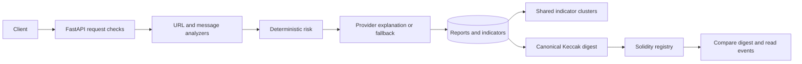

# Threat intelligence backend

The FastAPI service scans URLs and messages, stores reports and shared indicators, and publishes report digests to an Ethereum registry. The shared API contract is [API_CONTRACT.md](../docs/API_CONTRACT.md).

## Run on Windows

Run these commands from `backend/` in PowerShell with Python 3.12 installed. The local virtual environment works without Docker, a blockchain node or provider keys.

```powershell
py -3.12 -m venv .venv
.\.venv\Scripts\python.exe -m pip install -r requirements.txt
Copy-Item .env.example .env     # Initial setup only
.\.venv\Scripts\python.exe -m scripts.seed
.\.venv\Scripts\uvicorn.exe app.main:app --host 127.0.0.1 --port 8000
```

Open http://localhost:8000/docs for the interactive API. The seed command creates seven fixtures with stable IDs, including two synthetic clusters. It preserves published report content and attempts to publish the first fixture when the local registry is reachable.

### Local chain and Sepolia

Install Node.js 22 or 24 to use Hardhat. From `backend/`:

```powershell
npm ci --prefix contracts
.\scripts\start_local_chain.ps1
$env:CHAIN_MODE = 'local'
.\.venv\Scripts\python.exe -m scripts.seed
```

The helper starts or reuses a loopback-only Hardhat node and deploys the registry. To deploy manually on a running node, run `npx hardhat run scripts/deploy.ts --network localhost` from `backend/contracts/`. For Sepolia, configure a **throwaway wallet with faucet test ETH**, its private key, and its Sepolia RPC URL in the local environment. Deploy with `npx hardhat run scripts/deploy.ts --network sepolia` and set `CHAIN_MODE=sepolia` before starting the API. Deployment manifests contain public metadata. [Full chain instructions](scripts/dev_chain.md)

### Optional Docker Compose

Docker Compose v2.24 or newer can run the API with `docker compose up --build -d`, or the API and a development Hardhat node with `docker compose --profile chain up --build -d`. Wait for the registry deployment before running `docker compose exec api python -m scripts.seed`. Use `docker compose --profile chain down` to stop the services. Reports and deployment manifests use named volumes. Restarting the in-memory Hardhat node clears its chain history. Verify returns `not_found_on_chain` for a missing receipt. After redeploying the local registry, run `python -m scripts.reseed_chain_receipts` from the backend directory to restore local publications. The published host ports bind to loopback.

## Environment

| Variable | Default | Purpose |
|---|---|---|
| DATABASE_URL | sqlite:///./artifacts/reports.db | SQLAlchemy SQLite or PostgreSQL database |
| CORS_ORIGINS | http://localhost:3000 | Comma-separated browser origins |
| GOOGLE_SAFE_BROWSING_KEY | Empty | Optional Google v4 URL lookup |
| LLM_PROVIDER | anthropic | Select anthropic, openai or gemini |
| ANTHROPIC_MODEL | claude-haiku-5-5 | Anthropic explanation model |
| OPENAI_MODEL | gpt-4.1-mini | OpenAI explanation model |
| GEMINI_MODEL | gemini-3.5-flash | Gemini explanation model |
| ANTHROPIC_API_KEY | Empty | Anthropic authentication |
| OPENAI_API_KEY | Empty | OpenAI authentication |
| GEMINI_API_KEY | Empty | Gemini authentication |
| CHAIN_MODE | local | Select local or sepolia |
| LOCAL_RPC_URL | http://127.0.0.1:8545 | Trusted local RPC. Compose defaults to http://hardhat:8545 |
| CONTRACT_ADDRESS | Deployment manifest | Optional public registry address |
| SEPOLIA_RPC_URL | Empty | Sepolia RPC endpoint, potentially credential-bearing |
| DEPLOYER_PRIVATE_KEY | Empty | Sepolia throwaway signer |

Keep secrets in the ignored `.env` or process environment. Missing LLM credentials select the deterministic explanation. Missing threat-intelligence credentials appear as an unavailable check.

## API overview

All paths below start with `/api/v1`. POST endpoints have a ten-request-per-minute limit per client IP per endpoint per process. The maximum HTTP request body is 64 KiB.

| Method | Path | Result |
|---|---|---|
| GET | /health | Service status and version |
| POST | /scan/url | Persisted URL ScanReport |
| POST | /scan/message | Persisted message ScanReport, including evidence from up to five distinct links |
| GET | /reports | Filtered items and total; accepts risk, offset and limit |
| GET | /reports/{id} | Stored report and saved receipt |
| POST | /reports/{id}/publish | Publication receipt within the ScanReport |
| GET | /reports/{id}/verify | Hash comparison and ordered event history |
| GET | /intel/correlations | Deterministic clusters of two or more report IDs |

Contact arrays in message reports contain salted SHA-256 identifiers. The correlation salt persists with the database. Existing reports are backfilled from recoverable evidence on first initialization. The public error envelope contains `error.code` and `error.message`. Unpublished verification returns 409, oversized bodies return 413, invalid inputs return 422, throttling returns 429 and unavailable chain operations return 503.



## Verification

```powershell
.\.venv\Scripts\python.exe -m pytest -q
Push-Location contracts
npx hardhat test
Pop-Location
.\.venv\Scripts\python.exe -m scripts.run_demo_cases
```

The test suites use mocked external services or the in-process Hardhat chain. The demo uses real scan endpoints and external checks in a disposable database. Refresh the OpenPhish cache manually with `.\.venv\Scripts\python.exe -m scripts.refresh_feeds`. [Observed demo results](docs/TESTING_REPORT.md) · [Security methodology](docs/SECURITY_METHODOLOGY.md) · [Architecture](docs/ARCHITECTURE.md)
