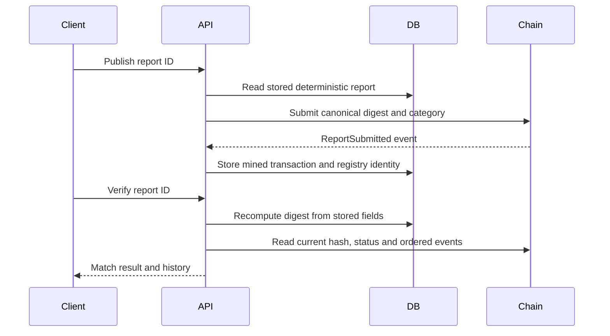

# Backend architecture

## Scan and persistence

FastAPI applies body limits, response headers and structured request logging. SlowAPI limits each POST route. The URL orchestrator runs local structure, DNS, RDAP, redirects, certificate, transparency, header and feed checks concurrently. Redirect and header analyzers share a fetched response. TLS and the initial page fetch share validated DNS resolution. Each analyzer records evidence or a failed-check entry.

Message scans extract up to five distinct links for analysis and aggregate their evidence into one parent report. The risk engine computes the classification before the explanation provider runs. An optional provider produces validated prose or falls back to an evidence template. SQLAlchemy commits the report and indicator rows in one transaction.

## Correlation index

Each indicators row has a composite primary key of report ID, type and value. An index on type, value and report ID supports the SQL group and join used by the correlations endpoint. A cluster requires at least two distinct reports with equal type and value. Ordered report IDs, deterministic cluster IDs and template summaries make repeated reads stable.

| Type | Source |
|---|---|
| ip | Approved addresses from the input hostname's scan-time DNS resolution and the pinned peers of HTTP response hops |
| redirect_target | The observed hostname of the response following a redirect |
| cert_fingerprint | SHA-256 of the presented leaf certificate |
| registrar | Digest of the IANA registrar ID from the RDAP registrar entity |
| phone, email | Domain-separated salted hashes of normalized extracted values |

The startup migration creates the installation salt and backfills recoverable report evidence atomically. Older reports may have no recorded peer certificate bytes, IPs or registrar ID; these observations cannot be reconstructed from issuer names or inferred later. Seed evidence is synthetic and repeatable.

## Publication and verification

Web3.py checks the configured chain ID and registry bytecode. Publication can recover an already-mined event after a lost database write. Status and revision reads use a common block height. The Solidity registry enforces reporter/owner update permissions and rejects duplicate hashes, including superseded hashes. An unreachable chain produces a 503 error. Local nodes lose history when restarted; Sepolia requires the deployment's original chain, address and funded signer.
