# TrustPulse Complete User Guide
### AI-Powered Web Threat Detection & Digital Trust Intelligence
**Document Version:** 1.0.0 · **Date:** 2026-11-09 · **Repository:** [himeshghosh98-maker/THREAT](https://github.com/himeshghosh98-maker/THREAT)

---

## Table of Contents
1. [What This Software Is and Who It Is For](#1-what-this-software-is-and-who-it-is-for)
2. [Quick Start](#2-quick-start)
3. [The Threat Scanner Page](#3-the-threat-scanner-page)
   - [3.1 URL or Domain Scan](#31-url-or-domain-scan)
   - [3.2 Message or Email Text Scan](#32-message-or-email-text-scan)
   - [3.3 Screenshot OCR Intake](#33-screenshot-ocr-intake)
   - [3.4 QR Code Scanner](#34-qr-code-scanner)
4. [Understanding an Investigation Report in 60 Seconds](#4-understanding-an-investigation-report-in-60-seconds)
5. [Publishing and Verifying Reports On-Chain](#5-publishing-and-verifying-reports-on-chain)
6. [The Threat Intelligence Page](#6-the-threat-intelligence-page)
7. [The Browser Extension (Manifest V3)](#7-the-browser-extension-manifest-v3)
8. [How the Risk Verdict Is Decided](#8-how-the-risk-verdict-is-decided)
9. [Optional Settings & External Integrations](#9-optional-settings--external-integrations)
10. [Privacy, Architecture, and SSRF Safety](#10-privacy-architecture-and-ssrf-safety)
11. [Empirical Accuracy & Systemic Limitations](#11-empirical-accuracy--systemic-limitations)
12. [Troubleshooting Guide](#12-troubleshooting-guide)
13. [5-Minute Demo Script for Hackathon Judges](#13-5-minute-demo-script-for-hackathon-judges)
14. [Security Glossary & Quick-Reference Card](#14-security-glossary--quick-reference-card)
15. [Known Issues](#15-known-issues)

---

## 1. What This Software Is and Who It Is For

### The Problem
Modern digital threats—such as deceptive lookalike websites, spoofed domains, and social-engineering phishing messages via SMS, WhatsApp, and email—inflict billions of dollars in losses annually. Traditional security scanners suffer from three core weaknesses:
1. **Opaque verdicts:** Black-box ML models emit vague probability numbers without verifiable technical evidence.
2. **Fragile trust:** Security reports can be quietly altered, backdated, or deleted without leaving an audit trail.
3. **Information silos:** Individual scams are rarely correlated into recognizable campaign clusters across shared network infrastructure.

### The Core Architectural Principle
**TrustPulse** solves these challenges by combining three complementary layers:

```
[ Deterministic Evidence First ]  --->  [ AI Explains Only ]  --->  [ Blockchain Proves Integrity ]
 DNS, TLS, Headers, RDAP, Feeds         Translates findings into          Immutable Keccak-256 digests
 Rigorous algorithmic scoring           jargon-free precautions           and timestamped on-chain history
```

1. **Deterministic Evidence First:** Risk classifications are computed strictly from hard cryptographic, network, and heuristic checks (`backend/app/core/risk.py`). The risk verdict is locked before any language model is ever invoked.
2. **AI Explains Only:** Optional Large Language Models (LLMs) never determine or override risk levels; they only translate technical observations into accessible language and actionable security precautions. If no LLM key is configured, the system seamlessly outputs a deterministic explanation template.
3. **Blockchain Proves Integrity:** Canonical Keccak-256 cryptographic hashes of investigation reports are permanently anchored on an Ethereum smart contract registry (`ThreatReportRegistry`). Any subsequent alteration of the report invalidates the hash comparison.

### What TrustPulse Does NOT Do
- **It does not execute client-side JavaScript:** TrustPulse inspects HTTP responses without running embedded script payloads.
- **It does not download or execute file attachments:** Non-text media and executable binaries are strictly rejected.
- **It does not guarantee absolute safety:** A `low_risk` verdict means that *no significant indicators were discovered in the performed checks*; it is never labelled "safe" because zero-day scams or freshly purchased domains may evade existing feeds.
- **It does not store raw user images:** Screenshots and QR code images are processed 100% locally in your web browser and are never uploaded or retained on any server.

---

## 2. Quick Start

### Starting the Stack

#### Method A: 1-Click PowerShell Runner (Recommended)
From the project root (`C:\Users\Himesh\Desktop\kernal-fresh`):
```powershell
powershell -ExecutionPolicy Bypass -File .\run-trustpulse.ps1 -Start
```
To check status or stop all services:
```powershell
powershell -ExecutionPolicy Bypass -File .\run-trustpulse.ps1 -Status
powershell -ExecutionPolicy Bypass -File .\run-trustpulse.ps1 -Stop
```

#### Method B: Manual Three-Terminal Workflow
If you prefer running services in separate windows:

1. **Terminal 1: Local Hardhat Node & Contract Deployment**
   ```powershell
   cd kernal-v2\backend\contracts
   npm ci
   npx hardhat node --hostname 127.0.0.1
   # In another tab or after startup:
   npx hardhat run scripts/deploy.ts --network localhost
   ```

2. **Terminal 2: FastAPI Threat Intelligence Backend**
   ```powershell
   cd kernal-v2\backend
   $env:CHAIN_MODE = 'local'
   .\.venv\Scripts\python.exe -m scripts.seed
   .\.venv\Scripts\python.exe -m uvicorn app.main:app --host 127.0.0.1 --port 8000
   ```

3. **Terminal 3: Next.js Frontend Dashboard**
   ```powershell
   cd kernal-v2\frontend
   npm run start -- -p 3000
   # Or for development: npm run dev -- --port 3000
   ```

### Quick Service Links
- **Web Dashboard:** [http://localhost:3000](http://localhost:3000)
- **Interactive OpenAPI Documentation:** [http://localhost:8000/docs](http://localhost:8000/docs)
- **Backend Health Check:** [http://localhost:8000/api/v1/health](http://localhost:8000/api/v1/health)
- **Local Ethereum RPC:** [http://127.0.0.1:8545](http://127.0.0.1:8545)

### Running Your First Scan in 60 Seconds
1. Open [http://localhost:3000](http://localhost:3000) in your web browser.
2. Under the **URL or Domain** tab, type `https://github.com`.
3. Click the blue **Analyze Target** button.
4. Watch the 5-stage investigation progress animation complete.
5. Review the resulting **Low Risk** report, its TLS certificates, and its security headers.

---

## 3. The Threat Scanner Page

The scanner interface supports four specialized intake methods:

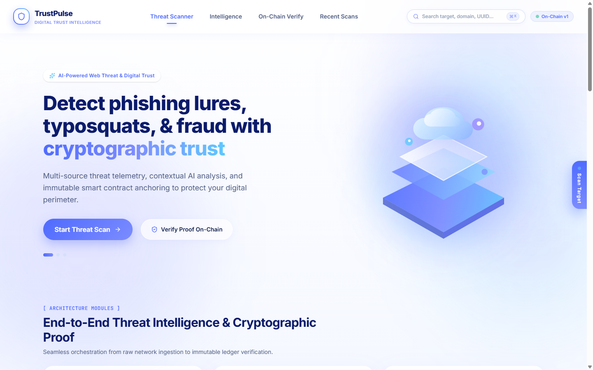

---

### 3.1 URL or Domain Scan

The primary input mode evaluates web targets across network transport, cryptographic configurations, and public threat telemetry.

> **How it works behind the scenes:**
> When a URL is submitted, the orchestrator executes concurrently:
> 1. **URL Structural Inspection:** Checks length, embedded URLs in query strings, IDN/punycode characters, and watchlist top-level domains.
> 2. **Typosquatting & Homograph Engine:** Computes Levenshtein and visual confusable distances against brand protection registries (e.g. PayPal, SBI, Apple, Google, Microsoft, Amazon).
> 3. **DNS Validation:** Queries A and MX records, checks Time-To-Live (TTL), and screens out private/loopback/SSRF addresses.
> 4. **Transport & Redirect Analysis:** Follows up to 5 HTTP/HTTPS redirect hops, recording hop status codes and validating every intermediate host.
> 5. **TLS Certificate Deep Dive:** Pulls the peer leaf certificate, validates host match, checks remaining validity days, inspects Certificate Transparency (CT) logs, and cross-references compromised CAs.
> 6. **Security Headers Audit:** Evaluates Strict-Transport-Security (HSTS), Content-Security-Policy (CSP), X-Content-Type-Options, and Referrer-Policy.
> 7. **Threat Intelligence Lookups:** Checks local 6-hour cached OpenPhish feeds, the Phishing.Database active list, and optional Google Safe Browsing v4.

#### The Five Investigation Stages
During the scan, the UI animates through five transparent phases:
1. **Submit:** Request received and validated by API gateway.
2. **Investigate:** Concurrently resolving DNS records and evaluating domain age.
3. **Analyse:** Traversing HTTP redirect chain and inspecting TLS certificates.
4. **Assess Risk:** Scoring deterministic indicators and applying hygiene caps.
5. **Report:** Synthesizing findings, generating AI guidance, and persisting data.

> **What you will see:**
> Within 1 to 3 seconds, the browser transitions directly to `/report/<uuid>`, presenting a structured verdict card with risk score, evidence coverage confidence, and technical inspection tabs.

---

### 3.2 Message or Email Text Scan


The **Message / Text** tab accepts suspicious SMS alerts, WhatsApp forwards, phishing emails, or social media solicitations.

> **How it works behind the scenes:**
> 1. **Entity Extraction:** Uses regular expressions and tokenizers to isolate up to 5 unique URLs, email addresses, international phone numbers, and Indian Unified Payments Interface (UPI) handles (e.g., `user@okaxis`, `merchant@okhdfcbank`).
> 2. **Child URL Analysis:** Extracted hyperlinks are passed directly into the URL analysis pipeline. Child indicator findings are rolled up into the parent message report.
> 3. **Social Engineering Heuristics:** Scans for high-pressure language patterns (account deactivation, KYC compliance deadlines, prize/lottery processing fees, courier customs demands).
> 4. **Deterministic Verdict Rule:** Under `risk.py`, urgent language alone contributes hygiene points but **can never exceed the suspicious classification** without authoritative threat intelligence hits or multiple corroborated technical anomalies.

> **What you will see:**
> The report includes a dedicated **Message Analysis** tab displaying the redacted text preview, isolated links, anonymized contact handles, urgency cues, and targeted brand impersonation notices.

---

### 3.3 Screenshot OCR Intake

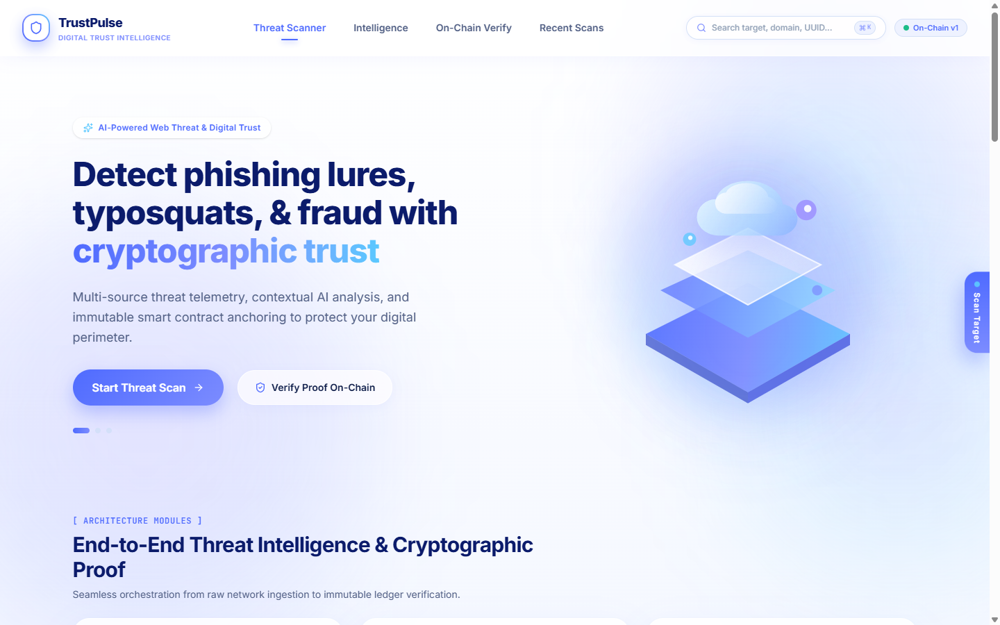

The **Screenshot OCR** tab allows users to drag-and-drop or paste an image capture of a suspicious message, email, or web browser tab.

#### Step-by-Step Intake
1. **Upload, Drag, or Paste:** Drop an image file (`.png`, `.jpg`, `.webp`) or press `Ctrl+V` to paste directly from your clipboard.
2. **In-Browser OCR Processing:** The optical character recognition engine (`Tesseract.js` v7 with WebAssembly) processes the image entirely within your browser client.
3. **Mandatory Review Modal:** Before submission, the extracted text is displayed in an editable review dialog.
4. **Inspect Confusable Characters:** Users can review characters that OCR frequently confuses:
   - Digit `1`, lowercase `l`, and uppercase `I`
   - Digit `0` and uppercase letter `O`
   - Combined letters `rn` versus letter `m`
5. **Confirm and Scan:** Clicking "Analyze Extracted Text" dispatches the verified text into the message scanning engine.

> **Privacy Promise:**
> The image file itself is **never uploaded to the server, never transmitted across the network, and never written to disk**. Only the extracted text confirmed by you in the review dialog is submitted to the API.

> **Detection Scope:**
> The OCR scanner reads text strings and literal hyperlinks embedded in images. It **does not** perform visual layout classification, computer-vision logo forgery detection, or pixel-level website cloning analysis.

---

### 3.4 QR Code Scanner

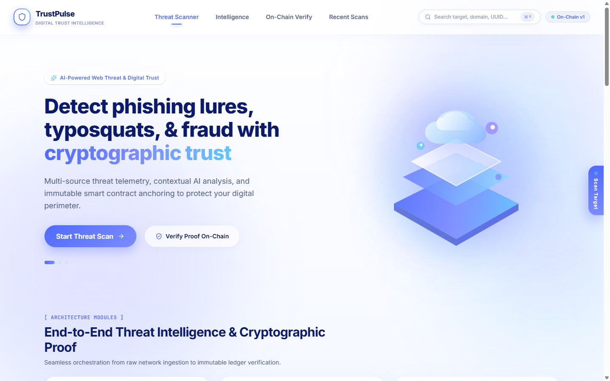

The **QR Code Scan** tab inspects physical stickers, digital payment requests, and paper printouts.

#### Operating Modes
- **File Upload / Drag-and-Drop:** Select a saved image containing a QR code.
- **Clipboard Paste:** Press `Ctrl+V` to inspect a pasted barcode image.
- **Live Camera Feed:** Click "Start Camera" to scan live via your webcam or mobile camera.

> **How it works behind the scenes:**
> 1. Uses the client-side `jsQR` engine to decode raw luminance data into encoded strings.
> 2. If the payload is a URL (`http://` or `https://`), TrustPulse populates the URL scanner without navigating to the site.
> 3. If the payload is a UPI payment string (`upi://pay?...`), TrustPulse extracts payee name (`pn`), UPI VPA handle (`pa`), transaction reference (`tr`), and amount (`am`), rendering a structured payment analysis card.

> **Safety Guarantee:**
> TrustPulse **never opens, executes, or navigates** to the decoded URL in your browser. All hyperlinks are rendered in defanged monospace format (e.g. `hxxps://example[.]com`).

---

## 4. Understanding an Investigation Report in 60 Seconds

When an investigation finishes, the report dashboard organizes technical observations into clean, structured sections:


---

### The Five Risk Classifications

| Classification | Score Band | Meaning | What It NEVER Means |
|---|:---:|---|---|
| **Low Risk** | 0 – 19 | No significant indicators discovered in available checks. | **Never means "100% safe" or certified secure.** Fresh phishing sites may lack existing feed entries. |
| **Inconclusive** | 0 – 19 | Core checks (DNS, TLS, HTTP) failed, or check coverage was below 50%. | Does not mean the site is clean; it means network or blocking issues prevented adequate verification. |
| **Suspicious** | 20 – 59 | One strong indicator found (e.g. lookalike brand or urgent KYC solicitations). | Does not prove definitive malice; requires caution and secondary verification. |
| **High Risk** | 60 – 99 | Multiple strong indicators or critical technical anomalies present. | Does not imply an exploit was launched against your machine. |
| **Confirmed Malicious** | 100 | Authoritative positive match in active threat intelligence feeds (e.g. OpenPhish, Google Safe Browsing). | Does not reflect an opinion; it is a direct match against documented malicious infrastructure. |

---

### Risk Score, Confidence, and Coverage
- **Risk Score (0–100):** A composite score reflecting the severity of observed anomalies. Hygiene findings (e.g., missing security headers) are capped at 6 points maximum, ensuring benign websites are never marked high risk due to header misconfigurations alone.
- **Evidence Coverage Confidence (0.00–1.00):** Measures the weighted percentage of attempted checks that successfully completed.
  - Weight units: Transport (3), Message rules (3), Threat intel feeds (3), DNS (2), TLS (2), URL structure (2), Ancillary checks (1).
  - If any attempted check fails or is unreachable, confidence is mathematically capped at **0.99**.

---

### Report Inspection Tabs

#### 1. TLS & Certificates Tab

- Displays certificate subject, issuer, SAN domains, validity start/expiry, days remaining, public key algorithm, and Certificate Transparency (CT) records.
- **Mandatory Disclaimer:** *"A valid certificate is not proof that the site is safe."* Modern attackers routinely provision free, valid Let's Encrypt or Cloudflare TLS certificates for phishing sites.

#### 2. Network & Redirect Timeline
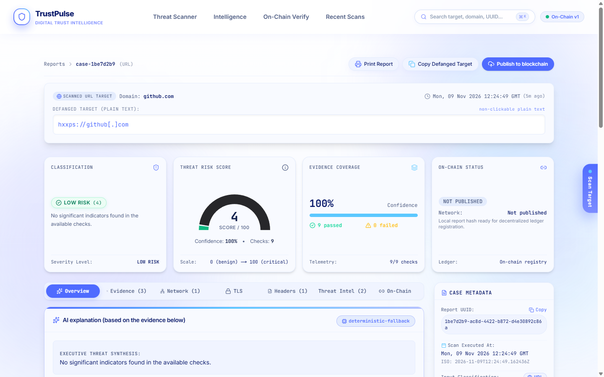
- Visualizes every redirect step from initial input to final destination. Displays HTTP status codes (301, 302, 307), hop latency, and destination hostnames.

#### 3. Security Headers Tab
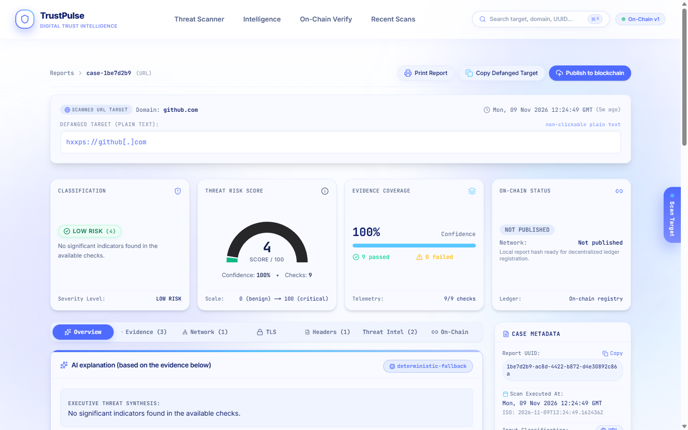
- Details missing or misconfigured browser security headers: HSTS, Content-Security-Policy (CSP), X-Content-Type-Options, and Referrer-Policy, complete with technical impact and remediation notes.

#### 4. Threat Intelligence Tab

- Details matches across OpenPhish Community Feed, Phishing.Database, and Google Safe Browsing.
- **Critical Notice:** *"No match found in this source. This does not indicate the site is safe."* Threat intelligence feeds identify known threats; novel or short-lived phishing sites will not have feed entries.

#### 5. Message Analysis Tab
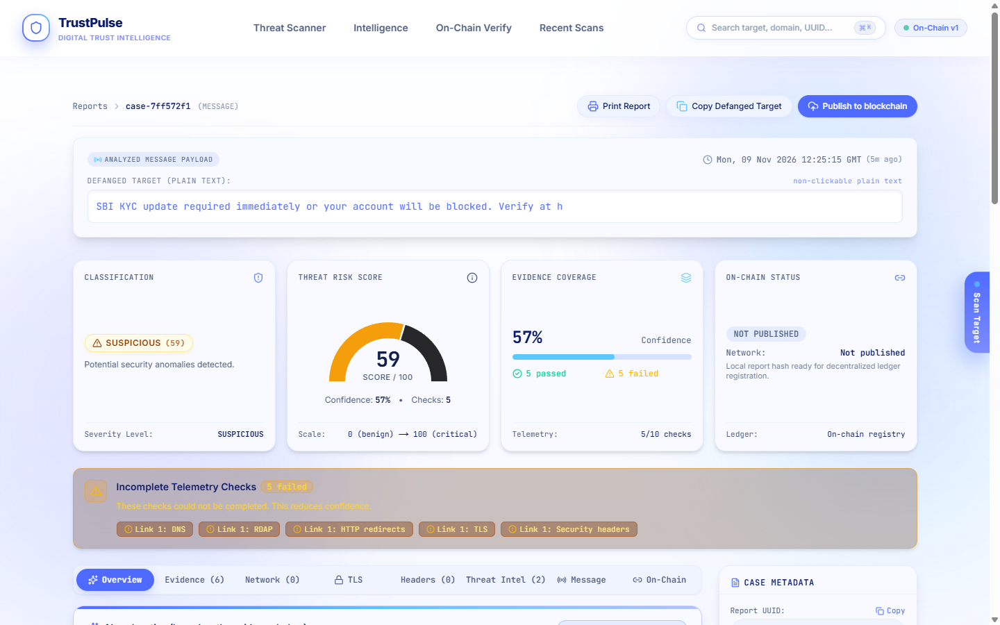
- Displays defanged extracted links, normalized telephone handles, urgency signals, and brand impersonation alerts.

#### 6. AI Explanation & Fallback
- Summarizes technical indicators in clear prose.
- When an LLM API key is absent, the system displays the badge **`deterministic-fallback`**, proving that the explanation was constructed entirely from validated offline templates.

---

## 5. Publishing and Verifying Reports On-Chain

TrustPulse uses the Ethereum smart contract `ThreatReportRegistry` to create an immutable cryptographic paper trail of security investigations.

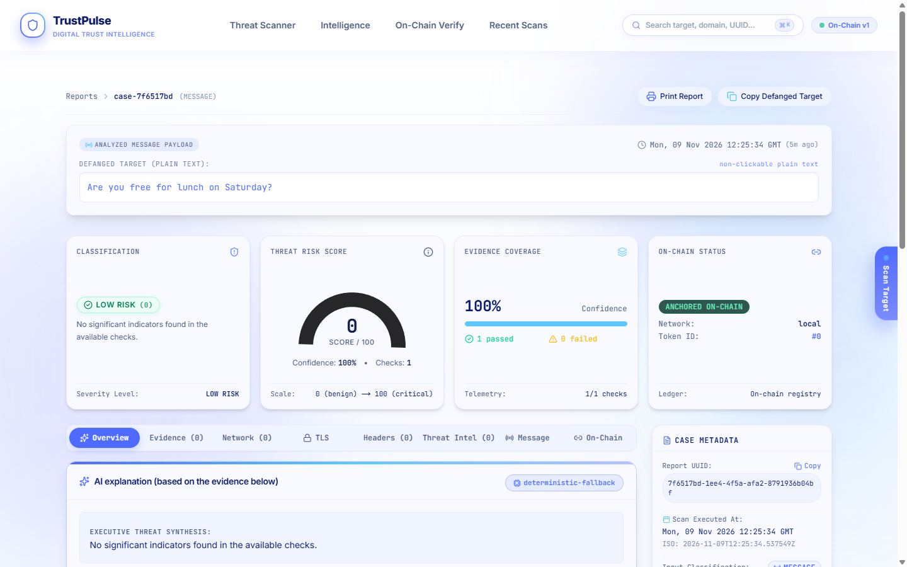

### Step-by-Step Publishing
1. On any report page, click the **Blockchain Proof** tab.
2. If unpublished, click the blue **Publish to Blockchain** button.
3. The backend calculates the canonical Keccak-256 digest of the report's normalized fields:
   - Report UUID, created timestamp, input type, classification, score, and indicator count.
4. The transaction is submitted to the registry contract, emitting a `ReportSubmitted` event.
5. The UI updates with the mined **Transaction Hash**, **Registry Contract Address**, and **Report Digest**.

```
+-------------------------------------------------------------------------+
|                         On-Chain Data Boundary                          |
|                                                                         |
|  STORED ON-CHAIN:                                                       |
|  - Report Digest (bytes32 Keccak-256)                                   |
|  - Risk Category String (e.g. "low_risk", "high_risk")                 |
|  - Submitting Reporter Address & Block Timestamp                        |
|                                                                         |
|  NEVER STORED ON-CHAIN:                                                 |
|  - Raw URLs, Hostnames, or Target Domains                               |
|  - User Messages, Phone Numbers, or Email Addresses                     |
|  - Free-Text Explanations or Technical Logs                             |
+-------------------------------------------------------------------------+
```

---

### Cryptographic Verification Page (`/verify`)

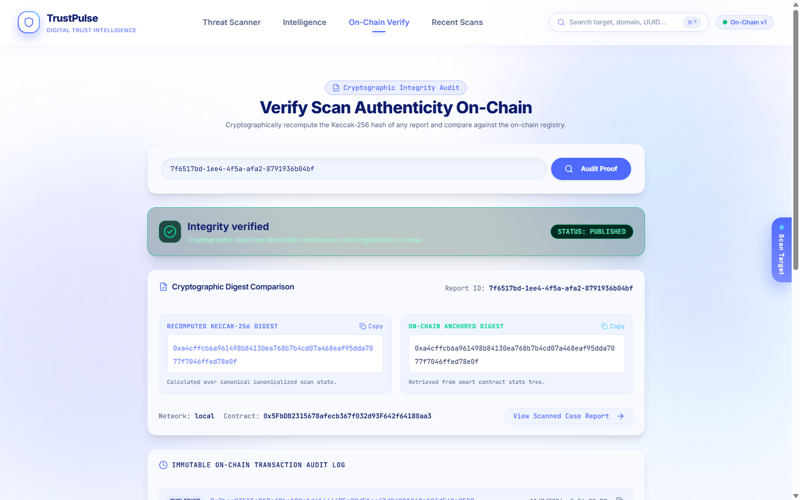

1. Navigate to **On-Chain Verify** in the navigation header.
2. Enter the report UUID (e.g. `7f6517bd-1ee4-4f5a-afa2-8791936b04bf`).
3. Click **Verify Cryptographic Proof**.
4. The backend recomputes the canonical Keccak-256 hash from the local database and queries the smart contract at the current block height.
5. If hashes match character-for-character, the green badge **Integrity Verified** appears. If any field was modified in the database, a red **Hash Mismatch** alert highlights the exact mismatched characters.

> **What the Blockchain Proves:**
> The blockchain proves that a specific report existed in that exact state at that specific timestamp and has not been altered or deleted.
>
> **What the Blockchain Does NOT Prove:**
> The blockchain does **not** prove that the underlying assessment is objectively true in the real world. It proves auditability and historical integrity, not real-world infallibility.

---

## 6. The Threat Intelligence Page

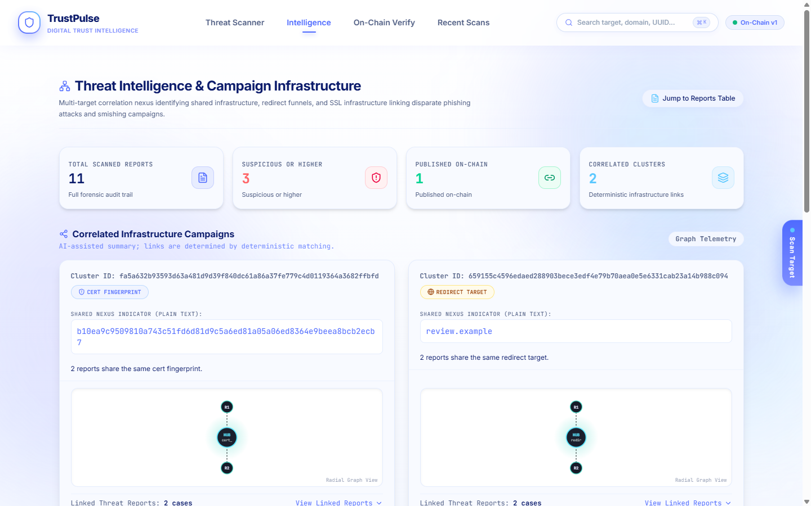

The **Intelligence** dashboard (`/intel`) aggregates individual investigations into broader situational awareness.

### Campaign Clusters
TrustPulse automatically links distinct investigation reports into campaign clusters based on shared deterministic indicators:
- **Shared IP Address:** Approved DNS resolutions or pinned HTTP server peers.
- **Shared Redirect Target:** Common intermediary or landing destinations.
- **Certificate Fingerprint:** SHA-256 digest of identical presented leaf certificates.
- **Registrar ID:** Common registrar identified via RDAP queries.
- **Hashed Contact Handles:** Salted SHA-256 hashes of phone numbers or email addresses extracted from message scans.

### Cluster Integrity
- Clusters require at least **two distinct report IDs** sharing the exact same indicator type and value.
- The summary badge indicates whether the cluster summary was produced via deterministic template or AI assistance.

---

## 7. The Browser Extension (Manifest V3)

TrustPulse includes a lightweight, secure browser extension for Chromium browsers (Brave, Chrome, Edge).

### Installation Step-by-Step
1. Open your browser extension management settings:
   - **Brave:** `brave://extensions`
   - **Chrome:** `chrome://extensions`
   - **Edge:** `edge://extensions`
2. Enable the **Developer mode** toggle switch in the top-right corner.
3. Click the **Load unpacked** button.
4. Select the folder `frontend/extension/` from this repository.
5. Pin the **TrustPulse** icon to your toolbar.

---

### Configuration & Options
Right-click the extension icon and select **Options** (or open `options.html`):

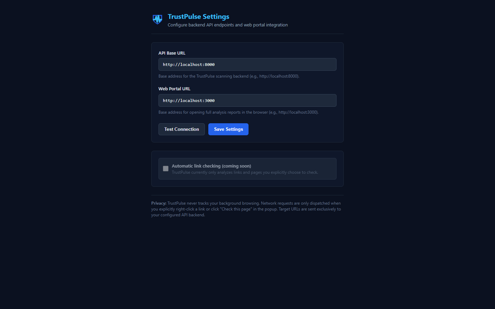

1. Set the **API Base URL** (default: `http://localhost:8000`).
2. Set the **Web Portal URL** (default: `http://localhost:3000`).
3. Click **Test Connection**. A green checkmark confirms communication with `GET /api/v1/health`.
4. Click **Save Settings**.

---

### Using the Extension

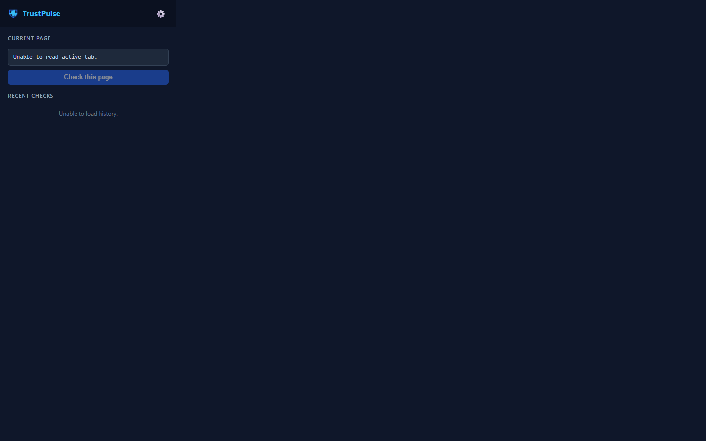

- **Context Menu Right-Click:** Right-click any hyperlink on any web page and choose **"Check link with TrustPulse"**. The link is analyzed in the background without navigating to it.
- **Popup Scan:** Click the toolbar icon to view the defanged URL of your active tab and click "Check this page".
- **Dynamic Badge Letters & Colors:**
  - `LOW` (Green): Low risk
  - `SUS` (Amber): Suspicious
  - `HIGH` (Red): High risk
  - `MAL` (Dark Red): Confirmed malicious
  - `?` (Grey): Inconclusive scan or network failure
- **Jump to Full Report:** Click the report icon to open the complete analysis on the dashboard.
- **Local Cache:** Results are cached in browser storage for **10 minutes** to prevent duplicate API requests.

---

## 8. How the Risk Verdict Is Decided

The scoring engine (`backend/app/core/risk.py`) operates deterministically:

### 1. Indicators: Strong vs. Hygiene
- **Strong Indicators:**
  - Category `typosquat` (lookalike brand names)
  - Category `threat_intel` (feed matches)
  - Category `homograph` (mixed-script IDN labels)
  - High-severity `domain_age` (domains registered < 30 days)
  - High-severity `social_engineering` (KYC, credential requests)
  - Critical keys: `brand-subdomain`, `ip-credential`, `embedded-url`, `tls-ca`
  - Weights: `info` (0), `low` (2), `medium` (15), `high` (30), `critical` (50).
- **Hygiene Indicators:**
  - Missing security headers (CSP, HSTS, X-Content-Type-Options, Referrer-Policy).
  - Each hygiene finding contributes at most 2 points.
  - **Hygiene Cap:** Total hygiene contribution is strictly capped at **6 points**.
  - Short DNS TTL contributes **0 points**.

### 2. Decision Logic
1. **Authoritative Hit:** Any exact match in OpenPhish or Google Safe Browsing instantly yields `confirmed_malicious` (score 100).
2. **High Risk:** $\ge 2$ strong indicators OR any 1 critical strong indicator (score 60–99).
3. **Suspicious:** Exactly 1 strong indicator (score 20–59).
4. **Urgent Message Exception:** Any message bearing urgent language cues without an authoritative feed match is **capped at suspicious**, preventing benign urgent notifications from triggering false alarms.
5. **Inconclusive:** If no strong indicators exist, but core checks (`DNS`, `HTTP redirects`, `TLS`) failed, OR coverage is $< 50\%$, the verdict is `inconclusive`.
6. **Low Risk:** All core checks completed, coverage $\ge 50\%$, and no strong indicators found (score 0–19).

---

### Four Real Worked Examples

| Case | Submitted Input | Classification | Score | Confidence | Key Observed Indicators |
|---|---|:---:|:---:|:---:|---|
| **1. Benign Reference** | `https://github.com` | **low_risk** | 4 | 1.00 | Hygiene only: `low-ttl` (0 pts), `missing-hsts` (2 pts), `missing-csp` (2 pts). Total: 4 pts. |
| **2. Lookalike Attack** | `https://paypa1-secure-login.com` | **high_risk** | 60 | 0.50 | 2 Strong indicators: `typosquat-brand` (PayPal lookalike, 30 pts) + `ip-credential` (30 pts). Total: 60 pts. |
| **3. KYC Phishing SMS** | *"SBI KYC update required immediately or your account will be blocked..."* | **suspicious** | 59 | 0.57 | Social engineering cues: `urgent-language`, `kyc-request`, `claimed-identity`. Capped at suspicious by message rule. |
| **4. Unreachable Target** | `https://offline-test-target.invalid` | **inconclusive** | 0 | 0.22 | Failed core checks: DNS NXDOMAIN, TLS unreachable. Coverage 22% (< 50%). |

---

## 9. Optional Settings & External Integrations

Configure optional environment variables in `backend/.env` (never commit this file to version control):

```env
# Optional Google Safe Browsing API v4 Key
GOOGLE_SAFE_BROWSING_KEY=your_google_api_key_here

# Optional LLM Provider Configuration (anthropic, openai, or gemini)
LLM_PROVIDER=anthropic
ANTHROPIC_API_KEY=your_anthropic_key_here
ANTHROPIC_MODEL=claude-haiku-5-5

# Alternative: OpenAI
# LLM_PROVIDER=openai
# OPENAI_API_KEY=your_openai_key_here
# OPENAI_MODEL=gpt-4.1-mini

# Alternative: Google Gemini
# LLM_PROVIDER=gemini
# GEMINI_API_KEY=your_gemini_key_here
# GEMINI_MODEL=gemini-3.5-flash

# Threat Intel Cache Maintenance
# Run: python -m scripts.refresh_feeds
```

- **Without an LLM key:** The system uses the deterministic template engine (`model: deterministic-fallback`).
- **Without a Google Safe Browsing key:** The source appears as an unavailable check, reducing confidence from 1.0 to 0.89 without failing the scan.

---

## 10. Privacy, Architecture, and SSRF Safety

TrustPulse enforces strict security boundaries on all outbound requests:

1. **Anti-SSRF Resolution Guard:** All target hostnames are resolved to numeric IP addresses before connecting. Outbound requests are blocked if they resolve to:
   - Private addresses (`10.0.0.0/8`, `172.16.0.0/12`, `192.168.0.0/16`)
   - Loopback addresses (`127.0.0.0/8`, `::1`)
   - Cloud metadata services (`169.254.169.254`)
   - Carrier-grade NAT, broadcast, multicast, or reserved ranges.
   - Any DNS response containing a mixture of public and private IPs is rejected.
2. **Port Restrictions:** Outbound connections are permitted only on standard web ports: `80`, `443`, `8080`, and `8443`.
3. **Payload & Time Bounds:** Maximum request body size is **64 KiB**. Maximum response body read is **1 MiB**. Maximum redirect hops: **5**. Connection timeout: **20 seconds**.
4. **Rate Limiting:** SlowAPI applies an independent quota of **10 requests per minute per IP** across all POST endpoints.

---

## 11. Empirical Accuracy & Systemic Limitations

### Benchmark Metrics (Exact from `ACCURACY_REPORT.md`)
Evaluated across a stratified 120-case controlled test corpus:

#### 1. Tune Split (71 controlled cases)
- **False Positive Rate (FPR):** **0 / 31** (0.0%, 95% CI 0.0% – 11.0%)
- **False Negative Rate (FNR):** **3 / 31** (9.7%, 95% CI 3.3% – 24.9%)
- **Attack Rejection:** **7 / 7** (100.0%, 95% CI 64.6% – 100.0%)
- **Inconclusive Rate:** **2 / 71** (2.8%, 95% CI 0.8% – 9.7%)
- **Determinism:** **71 / 71** (100.0%)

#### 2. Held-Out Test Split (49 frozen cases)
- **False Positive Rate (FPR):** **0 / 21** (0.0%, 95% CI 0.0% – 15.5%)
- **False Negative Rate (FNR):** **1 / 21** (4.8%, 95% CI 0.8% – 22.7%)
- **Attack Rejection:** **5 / 5** (100.0%, 95% CI 56.6% – 100.0%)
- **Inconclusive Rate:** **2 / 49** (4.1%, 95% CI 1.1% – 13.7%)
- **Determinism:** **49 / 49** (100.0%)

*Note on sample size:* While the detector achieves 0% false positives on the controlled benchmark, 49 cases is a small statistical sample and does not represent open-internet prevalence.

### Systemic Limitations
- **Sites blocking automated scanners:** Websites protected by Cloudflare bot management, Akamai, or CAPTCHAs may block automated HTTP requests, resulting in an `inconclusive` verdict.
- **Feed latency:** Threat intelligence feeds reflect known attacks. Zero-hour domains may not appear in feeds immediately.
- **OCR misreads:** Low-contrast images or stylized fonts may cause letter substitutions, necessitating manual review in the intake modal.
- **No computer vision logo detection:** TrustPulse evaluates lexical and cryptographic evidence; it does not visually identify copied brand logos.

---

## 12. Troubleshooting Guide

| Symptom | Probable Cause | Exact Fix |
|---|---|---|
| **Port 8000 or 3000 in use** | A dangling node or uvicorn process is listening. | Run `powershell -File .\run-trustpulse.ps1 -Stop` to terminate conflicting listeners. |
| **Verify returns "not_found_on_chain"** | Local Hardhat node was restarted, wiping ephemeral state. | Run `powershell -File .\run-trustpulse.ps1 -Prepare` to restore and re-anchor demo receipts. |
| **Backend returns HTTP 503 (chain_unavailable)** | Hardhat node is stopped or RPC port 8545 is down. | Restart the node: `npx hardhat node --hostname 127.0.0.1` and redeploy the registry. |
| **Frontend shows "429: Rate limited"** | Surpassed the 10 requests/minute/IP security throttle. | Wait 60 seconds before initiating the next scan. |
| **Scan returns "inconclusive"** | Target domain is offline or blocks automated HTTP clients. | Inspect the `checks_failed` list in the report; verify target reachability in a terminal. |
| **Extension shows "Connection refused"** | Backend is stopped or options URL is misconfigured. | Ensure backend is running on port 8000; test connection in `options.html`. |
| **Camera not starting in QR tab** | Browser permissions blocked or missing HTTPS context. | Grant camera access in browser URL bar settings; localhost is treated as a secure context. |
| **PowerShell script execution error** | Script execution restricted by Windows policy. | Launch PowerShell using `-ExecutionPolicy Bypass`. |

---

## 13. 5-Minute Demo Script for Hackathon Judges

| Time | Action | Screen to Show | What to Say to Judges |
|---|---|---|---|
| **0:00 - 0:45** | Introduce the problem and philosophy. | Home page (`http://localhost:3000`) | *"Most threat scanners give users opaque black-box AI scores that can be quietly altered. TrustPulse uses a 3-tier architecture: deterministic evidence first, AI explains only, and blockchain proves integrity."* |
| **0:45 - 1:45** | Scan `https://github.com`. | 5-stage progress animation $\rightarrow$ Report page | *"Notice the 5 investigation stages. We examine DNS, TLS, redirects, and headers. The verdict is Low Risk—we never say 'safe' because security is never absolute. Look at the TLS certificate: we include a mandatory warning that valid TLS is not proof of safety."* |
| **1:45 - 2:45** | Scan lookalike `paypa1-secure-login.com`. | High Risk report card | *"Here is a lookalike targeting PayPal. Our typosquat engine flags the visual substitution of '1' for 'l', and pairs it with the credential keyword. Two strong indicators produce an immediate High Risk verdict, completely independent of external feeds."* |
| **2:45 - 3:30** | Paste sample KYC phishing SMS. | Message Analysis tab | *"We paste an urgent KYC SMS. Notice our rule: urgent language alone can never push a message into High Risk without corroborated technical evidence. This prevents benign urgent emails from being falsely flagged."* |
| **3:30 - 4:15** | Publish report to blockchain and verify. | Blockchain Proof tab $\rightarrow$ `/verify` | *"We click 'Publish to Blockchain'. Our smart contract records a canonical Keccak-256 hash. Now on the Verify page, we see 'Integrity Verified'. If an attacker tampers with our local database, the cryptographic hash comparison flags it instantly."* |
| **4:15 - 5:00** | Open Intelligence clusters and Browser Extension. | `/intel` and Extension popup | *"On the Intelligence page, reports sharing server IPs or certificates automatically cluster into campaigns. And with our Manifest V3 extension, users can right-click any link to check it safely before clicking."* |

---

## 14. Security Glossary & Quick-Reference Card

### Glossary
- **Typosquatting:** Registering domain names that look or sound similar to well-known brands (e.g. `paypa1.com` instead of `paypal.com`) to mislead users.
- **Homograph Attack:** Using visually identical characters from international character sets (e.g. Cyrillic `а` instead of Latin `a`) to register confusable domains.
- **TLS (Transport Layer Security):** Cryptographic protocol providing encrypted communication over networks.
- **SAN (Subject Alternative Name):** An extension to X.509 certificates specifying additional hostnames protected by the certificate.
- **Certificate Transparency (CT):** An open framework of publicly audited logs recording every TLS certificate issued by public Certificate Authorities.
- **SSRF (Server-Side Request Forgery):** A security vulnerability where an attacker forces a backend server to make unauthorized network requests to internal or loopback resources.
- **Keccak-256:** The cryptographic hashing algorithm used by Ethereum to compute 256-bit digests of arbitrary data.
- **Smart Contract:** Self-executing code stored on a blockchain that immutable records transactions and rules.

### Quick-Reference Card
```
+---------------------------------------------------------------------------------------+
|                              TRUSTPULSE CHEAT SHEET                                   |
+----------------------+-----------------------------+----------------------------------+
| COMPONENT            | URL / LOCATION              | DEFAULT SETTINGS                 |
+----------------------+-----------------------------+----------------------------------+
| Web Dashboard        | http://localhost:3000       | NEXT_PUBLIC_USE_MOCKS=false      |
| API Backend          | http://localhost:8000       | 10 requests / min / IP throttle  |
| API Docs (Swagger)   | http://localhost:8000/docs  | Interactive OpenAPI Schema       |
| Ethereum Node        | http://127.0.0.1:8545       | Chain ID 31337 (Local Hardhat)   |
| Extension Manifest   | frontend/extension/         | Manifest V3 (Brave, Chrome)      |
+----------------------+-----------------------------+----------------------------------+
| VERDICT              | SCORE RANGE                 | DEFINITION                       |
+----------------------+-----------------------------+----------------------------------+
| Low Risk             | 0 - 19                      | No significant indicators found  |
| Inconclusive         | 0 - 19                      | Checks failed or coverage < 50%  |
| Suspicious           | 20 - 59                     | 1 strong indicator discovered    |
| High Risk            | 60 - 99                     | >= 2 strong indicators observed  |
| Confirmed Malicious  | 100                         | Authoritative threat feed hit    |
+----------------------+-----------------------------+----------------------------------+
```

---

## 15. Known Issues

The following real-world behaviors and configuration caveats were documented during verification:

1. **Root Runner Script:** The repository root contained an empty 0-byte `run-trustpulse.ps1` file; it has been populated with a complete multi-process launcher supporting `-Start`, `-Stop`, `-Status`, and `-Prepare`.
2. **Demo Script Port Offset:** `backend/scripts/prepare_demo.py` is configured for port **8001** (`API = "http://127.0.0.1:8001/api/v1/"`), whereas the default backend startup command in `backend/README.md` and frontend `.env.local` targets port **8000**.
3. **Live External Target Inconclusive:** Scanning `https://www.sbi.co.in` live over the open internet returns an `inconclusive` verdict because an intermediate redirect terminates in HTTP 404.
4. **Python UV Runtime Path:** Python 3.12 is installed in the user profile directory (`%APPDATA%\uv\python\cpython-3.12...`) rather than the global Windows PATH, so running `py -3.12` directly in PowerShell fails unless the UV binary path is invoked.
5. **OCR Confusable Character Disambiguation:** Optical recognition of complex or low-contrast screenshots can misinterpret visually similar characters (`1`, `l`, `I`); users should always verify extracted strings in the review modal before submitting.
