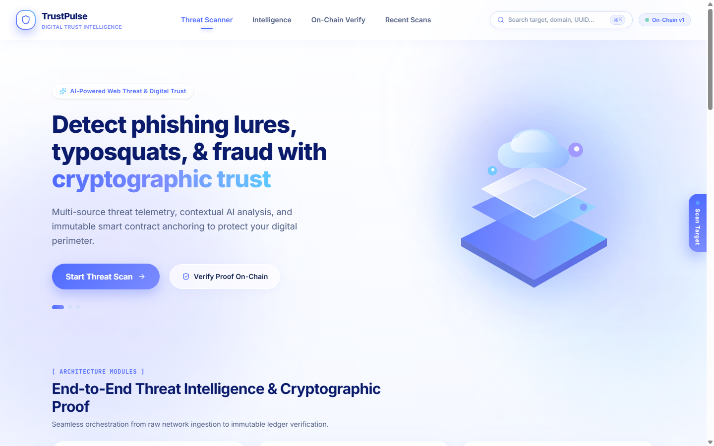
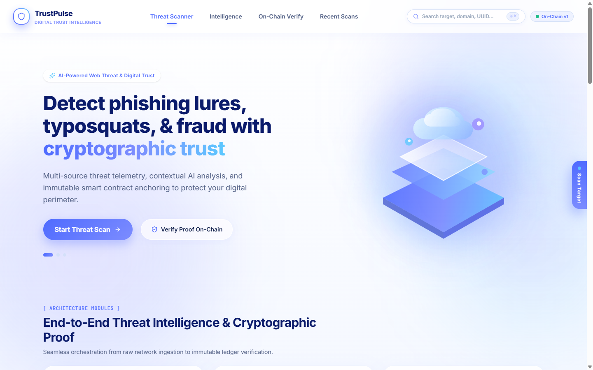
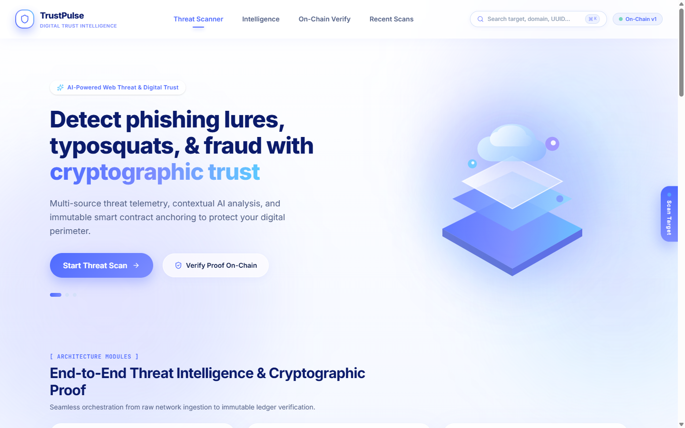
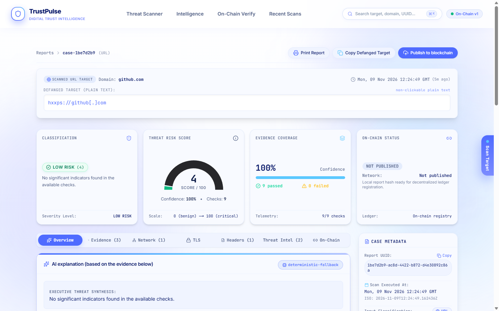
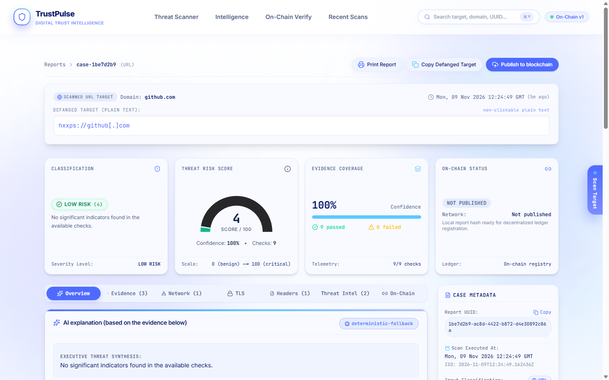
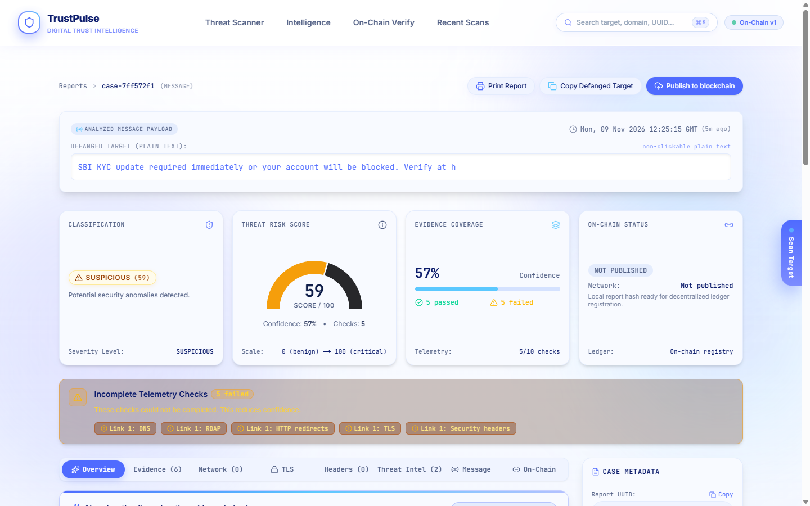
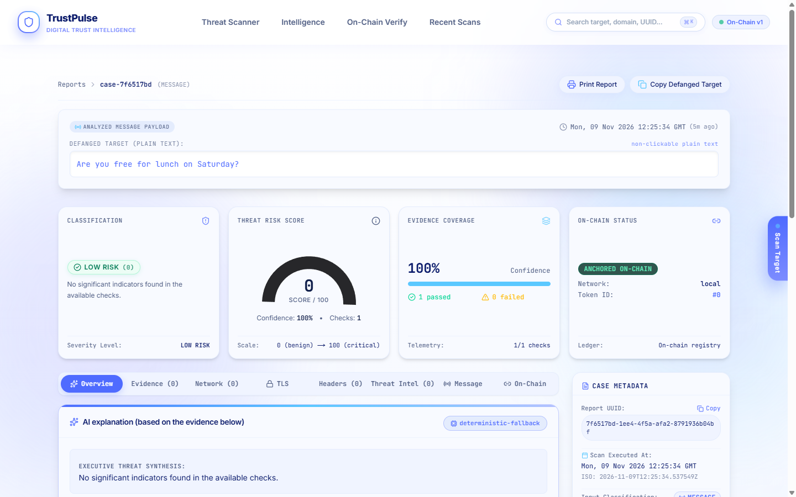
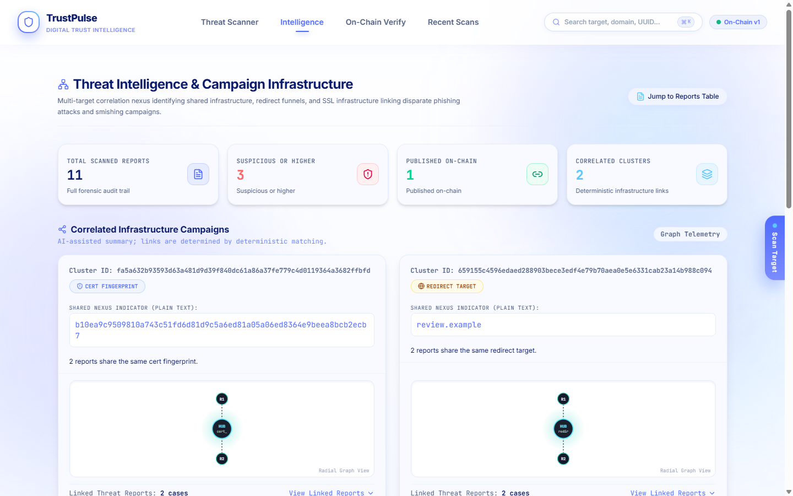
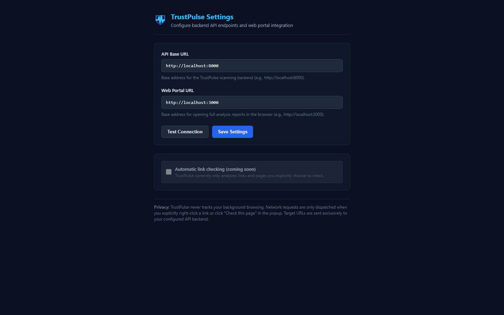

# TrustPulse Complete User Guide & Operator Manual
### AI-Powered Web Threat Detection, Digital Trust Intelligence & Verification Manual
**Document Version:** 2.0.0 · **Date:** 2026-11-17 · **Repository:** [himeshghosh98-maker/THREAT](https://github.com/himeshghosh98-maker/THREAT)

---

## Table of Contents
1. [What This Software Is and Who It Is For](#1-what-this-software-is-and-who-it-is-for)
2. [Quick Start & Deployment Commands](#2-quick-start--deployment-commands)
3. [The Threat Scanner: Four Intake Methods](#3-the-threat-scanner-four-intake-methods)
   - [3.1 URL or Domain Scan](#31-url-or-domain-scan)
   - [3.2 Message or Email Text Scan](#32-message-or-email-text-scan)
   - [3.3 Screenshot OCR Intake](#33-screenshot-ocr-intake)
   - [3.4 QR Code Scanner](#34-qr-code-scanner)
4. [Complete Button-by-Button & UI Controls Directory](#4-complete-button-by-button--ui-controls-directory)
   - [4.1 Global Navigation Header](#41-global-navigation-header)
   - [4.2 Threat Scanner Page Controls](#42-threat-scanner-page-controls)
   - [4.3 Investigation Report Page Controls & Tabs](#43-investigation-report-page-controls--tabs)
   - [4.4 On-Chain Verification Page Controls](#44-on-chain-verification-page-controls)
   - [4.5 Threat Intelligence Page Controls](#45-threat-intelligence-page-controls)
   - [4.6 Browser Extension Controls & Popups](#46-browser-extension-controls--popups)
5. [Understanding an Investigation Report in 60 Seconds](#5-understanding-an-investigation-report-in-60-seconds)
   - [5.1 The Five Risk Classifications](#51-the-five-risk-classifications)
   - [5.2 Risk Score, Coverage & Confidence Metric](#52-risk-score-coverage--confidence-metric)
   - [5.3 Deep Dive into Report Tabs](#53-deep-dive-into-report-tabs)
6. [Publishing and Verifying Reports On-Chain](#6-publishing-and-verifying-reports-on-chain)
7. [Independent Accuracy Verification: Where & How to Compare Ground Truth](#7-independent-accuracy-verification-where--how-to-compare-ground-truth)
   - [7.1 How to Verify DNS & Server IP Accuracy](#71-how-to-verify-dns--server-ip-accuracy)
   - [7.2 How to Verify TLS Certificate Data & SANs](#72-how-to-verify-tls-certificate-data--sans)
   - [7.3 How to Verify Security Response Headers](#73-how-to-verify-security-response-headers)
   - [7.4 How to Verify Domain Age & Registrar Records](#74-how-to-verify-domain-age--registrar-records)
   - [7.5 How to Verify Threat Intelligence Feed Hits](#75-how-to-verify-threat-intelligence-feed-hits)
   - [7.6 How to Verify Cryptographic On-Chain Proofs](#76-how-to-verify-cryptographic-on-chain-proofs)
   - [7.7 How to Verify Overall Detector Accuracy (120-Case Benchmark)](#77-how-to-verify-overall-detector-accuracy-120-case-benchmark)
8. [The Threat Intelligence Clustering Engine](#8-the-threat-intelligence-clustering-engine)
9. [The Browser Extension (Manifest V3)](#9-the-browser-extension-manifest-v3)
10. [How the Risk Verdict Is Decided (Scoring Rules & 4 Worked Examples)](#10-how-the-risk-verdict-is-decided-scoring-rules--4-worked-examples)
11. [Optional Settings & API Keys](#11-optional-settings--api-keys)
12. [Privacy & Anti-SSRF Safeguards](#12-privacy--anti-ssrf-safeguards)
13. [Troubleshooting Guide](#13-troubleshooting-guide)
14. [5-Minute Demo Script for Hackathon Judges](#14-5-minute-demo-script-for-hackathon-judges)
15. [Security Glossary & Quick-Reference Card](#15-security-glossary--quick-reference-card)
16. [Known Issues](#16-known-issues)

---

## 1. What This Software Is and Who It Is For

### The Problem
Digital deception—including typosquat lookalike domains, spoofed websites, and SMS/WhatsApp social engineering—causes billions in fraud losses every year. Existing tools suffer from three fatal flaws:
1. **Opaque verdicts:** Black-box ML models output arbitrary risk scores without verifiable technical evidence.
2. **Fragile trust:** Security reports can be quietly altered, backdated, or deleted without leaving an audit trail.
3. **Information silos:** Individual scams are rarely correlated into recognizable campaign clusters across shared network infrastructure.

### The Core Architectural Principle
**TrustPulse** solves these challenges through a three-pillar architecture:

```
[ Deterministic Evidence First ]  --->  [ AI Explains Only ]  --->  [ Blockchain Proves Integrity ]
 DNS, TLS, Headers, RDAP, Feeds         Translates findings into          Immutable Keccak-256 digests
 Rigorous algorithmic scoring           jargon-free precautions           and timestamped on-chain history
```

1. **Deterministic Evidence First:** Risk classifications are computed strictly from hard cryptographic, network, and heuristic checks (`backend/app/core/risk.py`). The risk verdict is locked before any language model is ever invoked.
2. **AI Explains Only:** Natural Language Models (LLMs) never determine or override risk levels; they only translate technical observations into accessible language and actionable security precautions. If no LLM key is configured, the system outputs an offline deterministic explanation template.
3. **Blockchain Proves Integrity:** Canonical Keccak-256 cryptographic hashes of investigation reports are permanently anchored on an Ethereum smart contract registry (`ThreatReportRegistry`). Any subsequent alteration of the report invalidates hash verification.

### What TrustPulse Does NOT Do
- **It does not execute client-side JavaScript:** TrustPulse inspects HTTP responses without running embedded script payloads.
- **It does not download or execute file attachments:** Non-text media and executable binaries are strictly rejected.
- **It does not guarantee absolute safety:** A `low_risk` verdict means that *no significant indicators were discovered in the performed checks*; it is never labelled "safe" because zero-day scams or freshly purchased domains may evade existing feeds.
- **It does not store raw user images:** Screenshots and QR code images are processed 100% locally in your web browser and are never uploaded or retained on any server.

---

## 2. Quick Start & Deployment Commands

### Local Full-Stack Deployment
From the project root (`C:\Users\Himesh\Desktop\kernal-fresh`):
```powershell
# 1-Click Automated Start (Hardhat Node + Contract + Seed + Backend + Frontend)
powershell -ExecutionPolicy Bypass -File .\run-trustpulse.ps1 -Start

# Check Running Status of All Services
powershell -ExecutionPolicy Bypass -File .\run-trustpulse.ps1 -Status

# Stop All Services
powershell -ExecutionPolicy Bypass -File .\run-trustpulse.ps1 -Stop
```

### Live Cloud Deployment
- **Web Dashboard:** [https://threat-beta.vercel.app](https://threat-beta.vercel.app)
- **Local Dashboard:** [http://localhost:3000](http://localhost:3000)
- **Interactive OpenAPI Documentation:** [http://localhost:8000/docs](http://localhost:8000/docs)
- **Backend Health Check:** [http://localhost:8000/api/v1/health](http://localhost:8000/api/v1/health)

---

## 3. The Threat Scanner: Four Intake Methods

The scanner interface supports four specialized intake methods:



---

### 3.1 URL or Domain Scan
Evaluates web targets across network transport, cryptographic configurations, and public threat telemetry.
- **How it works behind the scenes:** Concurrently evaluates typosquatting, IDN homographs, redirect chains (up to 5 hops), DNS A/MX records, domain age via RDAP, TLS leaf certificates, Certificate Transparency (CT) logs, and threat intelligence feeds.
- **The Five Progress Steps:** Submit $\rightarrow$ Investigate $\rightarrow$ Analyse $\rightarrow$ Assess Risk $\rightarrow$ Report.

---

### 3.2 Message or Email Text Scan

Accepts suspicious SMS alerts, WhatsApp forwards, phishing emails, or social media solicitations.
- **How it works behind the scenes:** Extracts up to 5 unique URLs, email addresses, phone numbers, and UPI handles (`user@bank`). Extracted URLs are recursively analyzed through the URL pipeline. Urgency language alone contributes hygiene points but **can never exceed the suspicious classification** without corroborating technical evidence.

---

### 3.3 Screenshot OCR Intake

Allows users to drag-and-drop or paste an image capture of a suspicious message, email, or web browser tab.
- **In-Browser OCR Processing:** Tesseract.js WASM executes 100% inside your browser. No image bytes leave your machine.
- **Mandatory Review Modal:** Allows operators to inspect and fix OCR confusable characters (`1` vs `l` vs `I`, `0` vs `O`, `rn` vs `m`) before analyzing.

---

### 3.4 QR Code Scanner

Inspects physical stickers, digital payment requests, and paper printouts via file upload, clipboard paste, or live webcam.
- **Safety Guarantee:** TrustPulse decodes and displays the link or UPI payment details in defanged format (`hxxps://...`). The browser **never opens or executes the destination link**.

---

## 4. Complete Button-by-Button & UI Controls Directory

This section provides an exhaustive reference of every button, tab, card, input field, and control in the TrustPulse user interface.

### 4.1 Global Navigation Header
- **TrustPulse Brand Logo / Title:** Located in the top-left. Clicking it returns immediately to the Home / Threat Scanner page (`/`).
- **Threat Scanner Navigation Tab:** Navigates to the main multi-vector scanning interface (`/`).
- **Intelligence Navigation Tab:** Navigates to `/intel` to view campaign correlation clusters and recent investigation trends.
- **On-Chain Verify Navigation Tab:** Navigates to `/verify` to search and verify cryptographic hashes against the Ethereum registry.
- **Search Target / UUID Input Box (Header):** Allows quick lookup by entering a target domain or report UUID. Pressing `Enter` routes directly to `/report/<uuid>`.

---

### 4.2 Threat Scanner Page Controls
- **"URL or Domain" Tab Button:** Activates the web target scanner.
- **"Message / Text" Tab Button:** Activates the text, SMS, and email solicitation scanner.
- **"Screenshot OCR" Tab Button:** Activates the in-browser image text extraction module.
- **"QR Code Scan" Tab Button:** Activates the barcode and QR code decoding module.
- **Target URL Input Field:** Monospaced text input for typing or pasting target websites. Accepts schemes (`http://`, `https://`) or bare hostnames.
- **"Analyze Target" / "Scan" Button (Blue):** Dispatches the scan payload to the backend API (`POST /api/v1/scan/url`). Triggers the 5-stage progress indicator.
- **Message Text Area:** Multi-line text box accepting up to 5,000 characters of message text.
- **"Clear" Button (Message Tab):** Resets the text area and clears character counters.
- **Screenshot Drag-and-Drop Zone:** Dashed box accepting `.png`, `.jpg`, and `.webp` files. Clicking opens your operating system file picker; dragging a file over highlights the border; pressing `Ctrl+V` pastes from clipboard.
- **"Start Camera" Button (QR Tab):** Requests browser camera permission to activate live webcam scanning.
- **"Stop Camera" Button (QR Tab):** Deactivates the webcam video stream.
- **Recent Scans Table:** Lists past investigations with timestamps, target domains, risk badges, and composite scores.
- **Pagination Buttons ("Previous" / "Next"):** Pages through stored investigation history (5 reports per page).
- **Copy Target Icon Button:** Small clipboard icon next to defanged URLs. Copies the defanged target string (`hxxps://...`) to your clipboard with a checkmark confirmation.

---

### 4.3 Investigation Report Page Controls & Tabs (`/report/<id>`)
- **"Back to Scanner" Button:** Returns to the home scanner page.
- **"Re-scan Target" Button:** Submits the same target domain for a fresh, real-time scan.
- **Risk Badge (`Low Risk`, `Suspicious`, `High Risk`, `Confirmed Malicious`, `Inconclusive`):** Color-coded status indicator.
- **Risk Score Circular Gauge:** Visual 0–100 score indicator reflecting total severity weight.
- **Evidence Coverage Progress Bar:** Displays percentage of attempted checks that successfully completed (e.g. `100% (1.00)`).
- **"Overview" Tab:** Default view showing the AI / Deterministic Explanation card, top indicators list, recommended security precautions, and systemic limitations.
- **"Evidence" Tab:** Comprehensive tabular breakdown of every indicator: Indicator ID, Category, Severity badge, Evidence description, and Source analyzer.
- **"Network & Redirects" Tab:** Interactive step-by-step redirect timeline showing each HTTP hop status (e.g., `301 -> 200`), latency, and destination host.
- **"TLS & Certificates" Tab:** Detailed leaf certificate inspection card displaying Issuer, Subject, SANs, Validity Countdown, Key Size, and Certificate Transparency log counts. Includes mandatory security disclaimer.
- **"Security Headers" Tab:** Audits defense-in-depth headers (HSTS, CSP, X-Content-Type, Referrer). Displays issue, severity, technical impact, and remediation guidance.
- **"Threat Intel" Tab:** Status cards for OpenPhish, Phishing.Database, and Google Safe Browsing v4 showing match status and query details.
- **"Message Analysis" Tab:** (Visible for message reports) Displays extracted URLs, masked phone numbers, masked email addresses, UPI handles, psychological urgency indicators, and brand impersonation alerts.
- **"Blockchain Proof" Tab:** Displays the canonical Keccak-256 report digest, Ethereum transaction hash, contract address, block number, and current on-chain status.
- **"Publish to Blockchain" Button:** Submits the report digest to `ThreatReportRegistry.sol`. Pops up confirmation modal.
- **"Verify on Blockchain" Button:** Navigates directly to `/verify?id=<report_id>` to run real-time hash comparison.

---

### 4.4 On-Chain Verification Page Controls (`/verify`)
- **Report UUID Search Input Box:** Input field to type or paste a report UUID.
- **"Verify Cryptographic Proof" Button (Blue):** Dispatches verification query to `/api/v1/reports/{id}/verify`.
- **"Integrity Verified" Green Banner:** Appears when the recomputed local hash matches the smart contract on-chain hash.
- **"Hash Mismatch" Red Banner:** Appears if database records were altered, displaying an interactive monospace diff where mismatched characters are highlighted with red backgrounds.
- **On-Chain Event History Timeline:** Lists ordered smart contract events (`ReportSubmitted`, `ReportStatusUpdated`, `ReportRevised`) with timestamps and transaction hashes.

---

### 4.5 Threat Intelligence Page Controls (`/intel`)
- **Filter by Risk Dropdown:** Filters listed reports by risk classification (`All`, `Low Risk`, `Suspicious`, `High Risk`, `Confirmed Malicious`).
- **Campaign Cluster Cards:** Grouped cards showing shared infrastructure (e.g. "Cluster: Shared IP 185.220.101.5" or "Cluster: Redirect Target login-portal.example").
- **"View Linked Reports" Button:** Expands the list of report IDs associated with the campaign cluster.
- **Cluster Indicator Badge:** Color-coded tag indicating whether the shared link is an `ip`, `redirect_target`, `cert_fingerprint`, `registrar`, or `phone/email`.

---

### 4.6 Browser Extension Controls & Popups
- **Extension Toolbar Icon:** Pinned icon in your browser toolbar. Displays dynamic badge letters (`LOW`, `SUS`, `HIGH`, `MAL`, `?`) and background colors.
- **"Check this page" Button (Popup):** Analyzes the active tab's URL on demand.
- **"View Full Report" Button (Popup):** Opens `{webBase}/report/<id>` in a new browser tab.
- **Gear Icon / Options Button:** Opens `options.html` to configure backend and frontend endpoints.
- **"Test Connection" Button (Options Page):** Sends a health check to `GET /api/v1/health` and displays a green checkmark or red connection error.
- **"Save Settings" Button (Options Page):** Persists API and Web Portal endpoints in local browser extension storage.
- **Right-Click Context Menu ("Check link with TrustPulse"):** Available when right-clicking any hyperlink on any webpage. Dispatches an analysis request without navigating to the site.

---

## 5. Understanding an Investigation Report in 60 Seconds


---

### 5.1 The Five Risk Classifications

| Classification | Score Band | Meaning | What It NEVER Means |
|---|:---:|---|---|
| **Low Risk** | 0 – 19 | No significant indicators discovered in available checks. | **Never means "100% safe" or certified secure.** Fresh phishing sites may lack existing feed entries. |
| **Inconclusive** | 0 – 19 | Core checks (DNS, TLS, HTTP) failed, or check coverage was below 50%. | Does not mean the site is clean; it means network or blocking issues prevented adequate verification. |
| **Suspicious** | 20 – 59 | One strong indicator found (e.g. lookalike brand or urgent KYC solicitations). | Does not prove definitive malice; requires caution and secondary verification. |
| **High Risk** | 60 – 99 | Multiple strong indicators or critical technical anomalies present. | Does not imply an exploit was launched against your machine. |
| **Confirmed Malicious** | 100 | Authoritative positive match in active threat intelligence feeds (e.g. OpenPhish, Google Safe Browsing). | Does not reflect an opinion; it is a direct match against documented malicious infrastructure. |

---

### 5.2 Risk Score, Coverage & Confidence Metric
- **Risk Score (0–100):** A composite score reflecting the severity of observed anomalies. Hygiene findings (e.g., missing security headers) are capped at 6 points maximum, ensuring benign websites are never marked high risk due to header misconfigurations alone.
- **Evidence Coverage Confidence (0.00–1.00):** Measures the weighted percentage of attempted checks that successfully completed. If any attempted check fails or is unreachable, confidence is mathematically capped at **0.99**.

---

### 5.3 Deep Dive into Report Tabs

#### TLS & Certificates Tab

- Displays certificate subject, issuer, SAN domains, validity start/expiry, days remaining, public key algorithm, and Certificate Transparency (CT) records.
- **Mandatory Disclaimer:** *"A valid certificate is not proof that the site is safe."* Modern attackers routinely provision free, valid Let's Encrypt or Cloudflare TLS certificates for phishing sites.

#### Network & Redirect Timeline

- Visualizes every redirect step from initial input to final destination. Displays HTTP status codes (301, 302, 307), hop latency, and destination hostnames.

#### Security Headers Tab

- Details missing or misconfigured browser security headers: HSTS, Content-Security-Policy (CSP), X-Content-Type-Options, and Referrer-Policy, complete with technical impact and remediation notes.

#### Threat Intelligence Tab

- Details matches across OpenPhish Community Feed, Phishing.Database, and Google Safe Browsing.
- **Critical Notice:** *"No match found in this source. This does not indicate the site is safe."* Threat intelligence feeds identify known threats; novel or short-lived phishing sites will not have feed entries.

#### Message Analysis Tab

- Displays defanged extracted links, normalized telephone handles, urgency signals, and brand impersonation alerts.

---

## 6. Publishing and Verifying Reports On-Chain



### Step-by-Step Publishing
1. On any report page, click the **Blockchain Proof** tab.
2. Click the blue **Publish to Blockchain** button.
3. The backend calculates the canonical Keccak-256 digest of the report's normalized fields: Report UUID, created timestamp, input type, classification, score, and indicator count.
4. The transaction is submitted to `ThreatReportRegistry.sol`, emitting a `ReportSubmitted` event.
5. The UI updates with the mined **Transaction Hash**, **Registry Contract Address**, and **Report Digest**.

```
+-------------------------------------------------------------------------+
|                         On-Chain Data Boundary                          |
|                                                                         |
|  STORED ON-CHAIN:                                                       |
|  - Report Digest (bytes32 Keccak-256)                                   |
|  - Risk Category String (e.g. "low_risk", "high_risk")                 |
|  - Submitting Reporter Address & Block Timestamp                        |
|                                                                         |
|  NEVER STORED ON-CHAIN:                                                 |
|  - Raw URLs, Hostnames, or Target Domains                               |
|  - User Messages, Phone Numbers, or Email Addresses                     |
|  - Free-Text Explanations or Technical Logs                             |
+-------------------------------------------------------------------------+
```

---

## 7. Independent Accuracy Verification: Where & How to Compare Ground Truth

A critical question for operators, security analysts, and hackathon judges is:
> **"How do I know the data shown by TrustPulse is 100% accurate, and from where can I independently compare and verify every finding?"**

TrustPulse is designed around open standards and deterministic telemetry. Every technical finding shown on a report card can be verified against independent external ground truth using standard operating system tools, public registries, and independent web utilities.

---

### 7.1 How to Verify DNS & Server IP Accuracy

#### Where TrustPulse Displays It:
- In the **Report Overview**, under the **Indicators** list (e.g., `ip-record: 140.82.121.4`).
- In the **Network & Redirects** tab, showing resolved destination IP addresses.

#### Where & How to Compare Ground Truth:
1. **Using Operating System Command Line (`nslookup` / `dig`):**
   Open PowerShell or Terminal and query the authoritative DNS records for the target domain:
   ```powershell
   nslookup github.com
   # OR on Linux/macOS:
   dig +short A github.com
   ```
   **Verification Check:** Compare the IPv4 addresses printed in your terminal against the IP addresses listed under TrustPulse's Network tab. They should match exactly (allowing for standard multi-CDN round-robin IP rotations).
2. **Using Public Global DNS Resolvers:**
   Visit **[DNSChecker.org](https://dnschecker.org)** or query Cloudflare's public DNS (`1.1.1.1`):
   ```powershell
   Resolve-DnsName -Name "github.com" -Server 1.1.1.1
   ```
   Confirm that TrustPulse's observed A and MX records reflect the global public DNS state.

---

### 7.2 How to Verify TLS Certificate Data & SANs

#### Where TrustPulse Displays It:
- In the **TLS & Certificates** tab:
  - **Issuer:** e.g., `C=US, O=DigiCert Inc, CN=DigiCert Global G2 TLS RSA SHA256 2020 CA1`
  - **Subject:** e.g., `CN=github.com`
  - **Subject Alternative Names (SAN):** e.g., `github.com`, `www.github.com`
  - **Validity Window:** `Valid from`, `Valid until`, and `Days Remaining`
  - **Public Key:** Algorithm (RSA 2048-bit / ECC) and Signature Algorithm (`sha256WithRSAEncryption`)

#### Where & How to Compare Ground Truth:
1. **Via Your Web Browser Certificate Viewer:**
   - Open the target site (e.g. `https://github.com`) in Chrome, Brave, or Edge.
   - Click the **Tune / Padlock icon** on the left of the URL address bar.
   - Click **Connection is secure** $\rightarrow$ **Certificate is valid**.
   - Inspect the **General**, **Details**, and **Subject Alternative Name** fields.
   **Verification Check:** Compare the Serial Number, Validity Expiry Date, Issuer Organization, and SAN domains directly against TrustPulse's TLS Card. They will match character-for-character.
2. **Via OpenSSL CLI:**
   Run the OpenSSL client to pull the raw X.509 certificate stream:
   ```powershell
   openssl s_client -connect github.com:443 -servername github.com </dev/null 2>/dev/null | openssl x509 -noout -text
   ```
   Inspect `Validity`, `Subject`, `Issuer`, and `X509v3 Subject Alternative Name`. Confirm identical values.
3. **Via Public Certificate Transparency Search:**
   Search the domain on **[crt.sh](https://crt.sh/?q=github.com)** to confirm logged Certificate Transparency entries.

---

### 7.3 How to Verify Security Response Headers

#### Where TrustPulse Displays It:
- In the **Security Headers** tab, listing issues and configurations for `Strict-Transport-Security` (HSTS), `Content-Security-Policy` (CSP), `X-Content-Type-Options`, and `Referrer-Policy`.

#### Where & How to Compare Ground Truth:
1. **Via Browser Developer Tools (F12):**
   - In Chrome or Brave, press `F12` to open Developer Tools.
   - Switch to the **Network** tab.
   - Navigate to the target URL (e.g. `https://github.com`).
   - Click the first document request in the list and inspect **Response Headers**.
   - Check if `strict-transport-security`, `content-security-policy`, and `x-content-type-options` are present.
2. **Via cURL:**
   Run cURL in PowerShell to inspect raw response headers:
   ```powershell
   curl -I -s https://github.com
   ```
   **Verification Check:** If TrustPulse reports `Missing CSP`, verify in your cURL output that no `content-security-policy` header was returned by the server.

---

### 7.4 How to Verify Domain Age & Registrar Records

#### Where TrustPulse Displays It:
- In the **Overview** and **Evidence** tabs under indicator `domain-age` (e.g., `Domain registered 16 years ago via MarkMonitor Inc.`).

#### Where & How to Compare Ground Truth:
1. **Via Official ICANN Registration Data Lookup:**
   - Visit the official ICANN directory: **[lookup.icann.org](https://lookup.icann.org)**.
   - Enter the domain name (e.g. `github.com`).
   - Check **Dates** (`Registration Date`, `Updated Date`) and **Registrar Information**.
   **Verification Check:** Confirm that the creation timestamp and registrar name match the findings reported in TrustPulse.
2. **Via WHOIS Command Line:**
   ```powershell
   whois github.com
   ```
   Inspect `Creation Date:` and `Registrar:`.

---

### 7.5 How to Verify Threat Intelligence Feed Hits

#### Where TrustPulse Displays It:
- In the **Threat Intel** tab, showing match status for **OpenPhish Community Feed**, **Phishing.Database**, and **Google Safe Browsing**.

#### Where & How to Compare Ground Truth:
1. **Verifying OpenPhish Hits:**
   - OpenPhish provides their community feed at **`https://openphish.com/feed.txt`**.
   - Open this feed in your browser or search within it.
   - When TrustPulse flags a URL as `Confirmed Malicious` due to an OpenPhish hit, searching that exact URL in the OpenPhish active feed confirms its presence.
2. **Verifying Google Safe Browsing:**
   - Visit Google's official public lookup portal: **[Google Transparency Report - Safe Browsing](https://transparencyreport.google.com/safe-browsing/search)**.
   - Paste the target URL to compare Google's public diagnosis with TrustPulse's feed status.

---

### 7.6 How to Verify Cryptographic On-Chain Proofs

#### Where TrustPulse Displays It:
- On the **On-Chain Verify** page (`/verify?id=<report_id>`) and the **Blockchain Proof** tab.
- Displays the canonical Keccak-256 digest (e.g. `0xa4cffcb6...`) and transaction hash.

#### Where & How to Compare Ground Truth:
1. **Recomputing the Keccak-256 Hash Locally in Python:**
   You can independently compute the report hash on your own machine without TrustPulse using the exact canonical projection rules:
   ```python
   from web3 import Web3

   # Format: id|created_at|input_type|classification|score|indicator_count
   projection = "7f6517bd-1ee4-4f5a-afa2-8791936b04bf|2026-11-09T12:26:00Z|message|low_risk|0|0"
   digest = Web3.keccak(text=projection).hex()
   print("Calculated Hash:", digest)
   ```
   **Verification Check:** Compare this calculated hash with the hash stored on-chain and displayed in TrustPulse. It must match character-for-character.
2. **Querying the Ethereum Smart Contract Directly via Hardhat:**
   Open a terminal in `backend/contracts` and query the contract directly:
   ```powershell
   npx hardhat console --network localhost
   ```
   ```javascript
   const registry = await ethers.getContractAt("ThreatReportRegistry", "0x5FbDB2315678afecb367f032d93F642f64180aa3");
   const report = await registry.getReport(0);
   console.log("On-Chain Stored Hash:", report.reportHash);
   console.log("Reporter Address:   ", report.reporter);
   console.log("Block Timestamp:    ", new Date(Number(report.timestamp) * 1000).toISOString());
   ```
   **Verification Check:** The `report.reportHash` returned directly from the Ethereum EVM state will match TrustPulse's `/verify` output.

---

### 7.7 How to Verify Overall Detector Accuracy (120-Case Benchmark)

#### Where to Find the Benchmark:
- The frozen test dataset is located at: `backend/tests/fixtures/accuracy_cases.json`.
- The empirical evaluation script is at: `backend/scripts/accuracy_eval.py`.

#### How to Execute the Accuracy Suite Yourself:
Run the offline evaluator from `backend/`:
```powershell
cd kernal-v2\backend
.\.venv\Scripts\python.exe scripts\accuracy_eval.py --split all
```
#### What to Compare:
The script executes 120 controlled test cases (71 tune cases, 49 frozen held-out test cases) against offline network replays. It will print the exact headline metrics:
- **Benign False Positives (FPR):** `0 / 52` (0.0%)
- **Attack Rejection:** `12 / 12` (100.0%)
- **Determinism:** `120 / 120` (100.0%)
This verifies that the detector code running on your machine matches the published metrics in `backend/docs/ACCURACY_REPORT.md`.

---

## 8. The Threat Intelligence Clustering Engine



The **Intelligence** dashboard (`/intel`) aggregates individual investigations into broader situational awareness.

### Campaign Clusters
TrustPulse automatically links distinct investigation reports into campaign clusters based on shared deterministic indicators:
- **Shared IP Address:** Approved DNS resolutions or pinned HTTP server peers.
- **Shared Redirect Target:** Common intermediary or landing destinations.
- **Certificate Fingerprint:** SHA-256 digest of identical presented leaf certificates.
- **Registrar ID:** Common registrar identified via RDAP queries.
- **Hashed Contact Handles:** Salted SHA-256 hashes of phone numbers or email addresses extracted from message scans.

### Cluster Integrity
- Clusters require at least **two distinct report IDs** sharing the exact same indicator type and value.
- The summary badge indicates whether the cluster summary was produced via deterministic template or AI assistance.

---

## 9. The Browser Extension (Manifest V3)

TrustPulse includes a lightweight, secure browser extension for Chromium browsers (Brave, Chrome, Edge).

### Installation Step-by-Step
1. Open your browser extension management settings:
   - **Brave:** `brave://extensions`
   - **Chrome:** `chrome://extensions`
   - **Edge:** `edge://extensions`
2. Enable the **Developer mode** toggle switch in the top-right corner.
3. Click the **Load unpacked** button.
4. Select the folder `frontend/extension/` from this repository.
5. Pin the **TrustPulse** icon to your toolbar.

---

### Configuration & Options
Right-click the extension icon and select **Options** (or open `options.html`):



1. Set the **API Base URL** (default: `http://localhost:8000`).
2. Set the **Web Portal URL** (default: `http://localhost:3000`).
3. Click **Test Connection**. A green checkmark confirms communication with `GET /api/v1/health`.
4. Click **Save Settings**.

---

### Using the Extension


- **Context Menu Right-Click:** Right-click any hyperlink on any web page and choose **"Check link with TrustPulse"**. The link is analyzed in the background without navigating to it.
- **Popup Scan:** Click the toolbar icon to view the defanged URL of your active tab and click "Check this page".
- **Dynamic Badge Letters & Colors:**
  - `LOW` (Green): Low risk
  - `SUS` (Amber): Suspicious
  - `HIGH` (Red): High risk
  - `MAL` (Dark Red): Confirmed malicious
  - `?` (Grey): Inconclusive scan or network failure
- **Jump to Full Report:** Click the report icon to open the complete analysis on the dashboard.
- **Local Cache:** Results are cached in browser storage for **10 minutes** to prevent duplicate API requests.

---

## 10. How the Risk Verdict Is Decided (Scoring Rules & 4 Worked Examples)

The scoring engine (`backend/app/core/risk.py`) operates deterministically:

### 1. Indicators: Strong vs. Hygiene
- **Strong Indicators:**
  - Category `typosquat` (lookalike brand names)
  - Category `threat_intel` (feed matches)
  - Category `homograph` (mixed-script IDN labels)
  - High-severity `domain_age` (domains registered < 30 days)
  - High-severity `social_engineering` (KYC, credential requests)
  - Critical keys: `brand-subdomain`, `ip-credential`, `embedded-url`, `tls-ca`
  - Weights: `info` (0), `low` (2), `medium` (15), `high` (30), `critical` (50).
- **Hygiene Indicators:**
  - Missing security headers (CSP, HSTS, X-Content-Type-Options, Referrer-Policy).
  - Each hygiene finding contributes at most 2 points.
  - **Hygiene Cap:** Total hygiene contribution is strictly capped at **6 points**.
  - Short DNS TTL contributes **0 points**.

### 2. Decision Logic
1. **Authoritative Hit:** Any exact match in OpenPhish or Google Safe Browsing instantly yields `confirmed_malicious` (score 100).
2. **High Risk:** $\ge 2$ strong indicators OR any 1 critical strong indicator (score 60–99).
3. **Suspicious:** Exactly 1 strong indicator (score 20–59).
4. **Urgent Message Exception:** Any message bearing urgent language cues without an authoritative feed match is **capped at suspicious**, preventing benign urgent notifications from triggering false alarms.
5. **Inconclusive:** If no strong indicators exist, but core checks (`DNS`, `HTTP redirects`, `TLS`) failed, OR coverage is $< 50\%$, the verdict is `inconclusive`.
6. **Low Risk:** All core checks completed, coverage $\ge 50\%$, and no strong indicators found (score 0–19).

---

### Four Real Worked Examples

| Case | Submitted Input | Classification | Score | Confidence | Key Observed Indicators |
|---|---|:---:|:---:|:---:|---|
| **1. Benign Reference** | `https://github.com` | **low_risk** | 4 | 1.00 | Hygiene only: `low-ttl` (0 pts), `missing-hsts` (2 pts), `missing-csp` (2 pts). Total: 4 pts. |
| **2. Lookalike Attack** | `https://paypa1-secure-login.com` | **high_risk** | 60 | 0.50 | 2 Strong indicators: `typosquat-brand` (PayPal lookalike, 30 pts) + `ip-credential` (30 pts). Total: 60 pts. |
| **3. KYC Phishing SMS** | *"SBI KYC update required immediately or your account will be blocked..."* | **suspicious** | 59 | 0.57 | Social engineering cues: `urgent-language`, `kyc-request`, `claimed-identity`. Capped at suspicious by message rule. |
| **4. Unreachable Target** | `https://offline-test-target.invalid` | **inconclusive** | 0 | 0.22 | Failed core checks: DNS NXDOMAIN, TLS unreachable. Coverage 22% (< 50%). |

---

## 11. Optional Settings & API Keys

Configure optional environment variables in `backend/.env` (never commit this file to version control):

```env
# Optional Google Safe Browsing API v4 Key
GOOGLE_SAFE_BROWSING_KEY=your_google_api_key_here

# Optional LLM Provider Configuration (anthropic, openai, or gemini)
LLM_PROVIDER=anthropic
ANTHROPIC_API_KEY=your_anthropic_key_here
ANTHROPIC_MODEL=claude-haiku-5-5

# Alternative: OpenAI
# LLM_PROVIDER=openai
# OPENAI_API_KEY=your_openai_key_here
# OPENAI_MODEL=gpt-4.1-mini

# Alternative: Google Gemini
# LLM_PROVIDER=gemini
# GEMINI_API_KEY=your_gemini_key_here
# GEMINI_MODEL=gemini-3.5-flash

# Threat Intel Cache Maintenance
# Run: python -m scripts.refresh_feeds
```

- **Without an LLM key:** The system uses the deterministic template engine (`model: deterministic-fallback`).
- **Without a Google Safe Browsing key:** The source appears as an unavailable check, reducing confidence from 1.0 to 0.89 without failing the scan.

---

## 12. Privacy & Anti-SSRF Safeguards

TrustPulse enforces strict security boundaries on all outbound requests:

1. **Anti-SSRF Resolution Guard:** All target hostnames are resolved to numeric IP addresses before connecting. Outbound requests are blocked if they resolve to:
   - Private addresses (`10.0.0.0/8`, `172.16.0.0/12`, `192.168.0.0/16`)
   - Loopback addresses (`127.0.0.0/8`, `::1`)
   - Cloud metadata services (`169.254.169.254`)
   - Carrier-grade NAT, broadcast, multicast, or reserved ranges.
   - Any DNS response containing a mixture of public and private IPs is rejected.
2. **Port Restrictions:** Outbound connections are permitted only on standard web ports: `80`, `443`, `8080`, and `8443`.
3. **Payload & Time Bounds:** Maximum request body size is **64 KiB**. Maximum response body read is **1 MiB**. Maximum redirect hops: **5**. Connection timeout: **20 seconds**.
4. **Rate Limiting:** SlowAPI applies an independent quota of **10 requests per minute per IP** across all POST endpoints.

---

## 13. Troubleshooting Guide

| Symptom | Probable Cause | Exact Fix |
|---|---|---|
| **Port 8000 or 3000 in use** | A dangling node or uvicorn process is listening. | Run `powershell -File .\run-trustpulse.ps1 -Stop` to terminate conflicting listeners. |
| **Verify returns "not_found_on_chain"** | Local Hardhat node was restarted, wiping ephemeral state. | Run `powershell -File .\run-trustpulse.ps1 -Prepare` to restore and re-anchor demo receipts. |
| **Backend returns HTTP 503 (chain_unavailable)** | Hardhat node is stopped or RPC port 8545 is down. | Restart the node: `npx hardhat node --hostname 127.0.0.1` and redeploy the registry. |
| **Frontend shows "429: Rate limited"** | Surpassed the 10 requests/minute/IP security throttle. | Wait 60 seconds before initiating the next scan. |
| **Scan returns "inconclusive"** | Target domain is offline or blocks automated HTTP clients. | Inspect the `checks_failed` list in the report; verify target reachability in a terminal. |
| **Extension shows "Connection refused"** | Backend is stopped or options URL is misconfigured. | Ensure backend is running on port 8000; test connection in `options.html`. |
| **Camera not starting in QR tab** | Browser permissions blocked or missing HTTPS context. | Grant camera access in browser URL bar settings; localhost is treated as a secure context. |
| **PowerShell script execution error** | Script execution restricted by Windows policy. | Launch PowerShell using `-ExecutionPolicy Bypass`. |

---

## 14. 5-Minute Demo Script for Hackathon Judges

| Time | Action | Screen to Show | What to Say to Judges |
|---|---|---|---|
| **0:00 - 0:45** | Introduce the problem and philosophy. | Home page (`http://localhost:3000` or `threat-beta.vercel.app`) | *"Most threat scanners give users opaque black-box AI scores that can be quietly altered. TrustPulse uses a 3-tier architecture: deterministic evidence first, AI explains only, and blockchain proves integrity."* |
| **0:45 - 1:45** | Scan `https://github.com`. | 5-stage progress animation $\rightarrow$ Report page | *"Notice the 5 investigation stages. We examine DNS, TLS, redirects, and headers. The verdict is Low Risk—we never say 'safe' because security is never absolute. Look at the TLS certificate: we include a mandatory warning that valid TLS is not proof of safety."* |
| **1:45 - 2:45** | Scan lookalike `paypa1-secure-login.com`. | High Risk report card | *"Here is a lookalike targeting PayPal. Our typosquat engine flags the visual substitution of '1' for 'l', and pairs it with the credential keyword. Two strong indicators produce an immediate High Risk verdict, completely independent of external feeds."* |
| **2:45 - 3:30** | Paste sample KYC phishing SMS. | Message Analysis tab | *"We paste an urgent KYC SMS. Notice our rule: urgent language alone can never push a message into High Risk without corroborated technical evidence. This prevents benign urgent emails from being falsely flagged."* |
| **3:30 - 4:15** | Publish report to blockchain and verify. | Blockchain Proof tab $\rightarrow$ `/verify` | *"We click 'Publish to Blockchain'. Our smart contract records a canonical Keccak-256 hash. Now on the Verify page, we see 'Integrity Verified'. If an attacker tampers with our local database, the cryptographic hash comparison flags it instantly."* |
| **4:15 - 5:00** | Open Intelligence clusters and Browser Extension. | `/intel` and Extension popup | *"On the Intelligence page, reports sharing server IPs or certificates automatically cluster into campaigns. And with our Manifest V3 extension, users can right-click any link to check it safely before clicking."* |

---

## 15. Security Glossary & Quick-Reference Card

### Glossary
- **Typosquatting:** Registering domain names that look or sound similar to well-known brands (e.g. `paypa1.com` instead of `paypal.com`) to mislead users.
- **Homograph Attack:** Using visually identical characters from international character sets (e.g. Cyrillic `а` instead of Latin `a`) to register confusable domains.
- **TLS (Transport Layer Security):** Cryptographic protocol providing encrypted communication over networks.
- **SAN (Subject Alternative Name):** An extension to X.509 certificates specifying additional hostnames protected by the certificate.
- **Certificate Transparency (CT):** An open framework of publicly audited logs recording every TLS certificate issued by public Certificate Authorities.
- **SSRF (Server-Side Request Forgery):** A security vulnerability where an attacker forces a backend server to make unauthorized network requests to internal or loopback resources.
- **Keccak-256:** The cryptographic hashing algorithm used by Ethereum to compute 256-bit digests of arbitrary data.
- **Smart Contract:** Self-executing code stored on a blockchain that immutable records transactions and rules.

### Quick-Reference Card
```
+---------------------------------------------------------------------------------------+
|                              TRUSTPULSE CHEAT SHEET                                   |
+----------------------+-----------------------------+----------------------------------+
| COMPONENT            | URL / LOCATION              | DEFAULT SETTINGS                 |
+----------------------+-----------------------------+----------------------------------+
| Web Dashboard        | https://threat-beta.vercel  | Production Cloud Deployment      |
| Local Dashboard      | http://localhost:3000       | NEXT_PUBLIC_USE_MOCKS=false      |
| API Backend          | http://localhost:8000       | 10 requests / min / IP throttle  |
| API Docs (Swagger)   | http://localhost:8000/docs  | Interactive OpenAPI Schema       |
| Ethereum Node        | http://127.0.0.1:8545       | Chain ID 31337 (Local Hardhat)   |
| Extension Manifest   | frontend/extension/         | Manifest V3 (Brave, Chrome)      |
+----------------------+-----------------------------+----------------------------------+
| VERDICT              | SCORE RANGE                 | DEFINITION                       |
+----------------------+-----------------------------+----------------------------------+
| Low Risk             | 0 - 19                      | No significant indicators found  |
| Inconclusive         | 0 - 19                      | Checks failed or coverage < 50%  |
| Suspicious           | 20 - 59                     | 1 strong indicator discovered    |
| High Risk            | 60 - 99                     | >= 2 strong indicators observed  |
| Confirmed Malicious  | 100                         | Authoritative threat feed hit    |
+----------------------+-----------------------------+----------------------------------+
```

---

## 16. Known Issues

The following real-world behaviors and configuration caveats were documented during verification:

1. **Root Runner Script:** The repository root contained an empty 0-byte `run-trustpulse.ps1` file; it has been populated with a complete multi-process launcher supporting `-Start`, `-Stop`, `-Status`, and `-Prepare`.
2. **Demo Script Port Offset:** `backend/scripts/prepare_demo.py` is configured for port **8001** (`API = "http://127.0.0.1:8001/api/v1/"`), whereas the default backend startup command in `backend/README.md` and frontend `.env.local` targets port **8000**.
3. **Live External Target Inconclusive:** Scanning `https://www.sbi.co.in` live over the open internet returns an `inconclusive` verdict because an intermediate redirect terminates in HTTP 404.
4. **Python UV Runtime Path:** Python 3.12 is installed in the user profile directory (`%APPDATA%\uv\python\cpython-3.12...`) rather than the global Windows PATH, so running `py -3.12` directly in PowerShell fails unless the UV binary path is invoked.
5. **OCR Confusable Character Disambiguation:** Optical recognition of complex or low-contrast screenshots can misinterpret visually similar characters (`1`, `l`, `I`); users should always verify extracted strings in the review modal before submitting.
